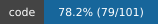
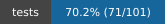

# Adaptive_JSON5

Adaptive_JSON5 is a C++17 JSON5 and JSON parser for automotive and embedded software.
It parses into memory you provide, never touches the heap, and reports every failure
as a value, so it runs the same on a bare-metal microcontroller and on a
high-performance computer. It is developed towards ISO 26262 ASIL B(D) and ISO/SAE
21434 CAL 4, with its safety and security work documented in the open.

## Project status

| Release | Status |
| --- | --- |
| Version | [](https://github.com/Romanr92/Adaptive_JSON5/releases) |

### Requirements traceability

| Metric | Status / report |
| --- | --- |
| Mapped to code | [](https://github.com/Romanr92/Adaptive_JSON5/actions/workflows/requirements-traceability.yml) |
| Mapped to tests | [](https://github.com/Romanr92/Adaptive_JSON5/actions/workflows/requirements-traceability.yml) |
| All mapped tests passing | [](https://github.com/Romanr92/Adaptive_JSON5/actions/workflows/requirements-traceability.yml) |

### Code coverage

| Metric | Status / report |
| --- | --- |
| Line coverage | [](https://github.com/Romanr92/Adaptive_JSON5/actions/workflows/unit-test-coverage.yml) |
| Function coverage | [](https://github.com/Romanr92/Adaptive_JSON5/actions/workflows/unit-test-coverage.yml) |
| Branch coverage | [](https://github.com/Romanr92/Adaptive_JSON5/actions/workflows/unit-test-coverage.yml) |

### Testing and validation

| Check | Workflow / report |
| --- | --- |
| Unit tests | [](https://github.com/Romanr92/Adaptive_JSON5/actions/workflows/unit-tests.yml) |
| Compiler diversity | [](https://github.com/Romanr92/Adaptive_JSON5/actions/workflows/compiler-diversity.yml) |
| JSON / JSON5 validation | [](https://github.com/Romanr92/Adaptive_JSON5/actions/workflows/validation-tests.yml) |
| Coverage workflow | [](https://github.com/Romanr92/Adaptive_JSON5/actions/workflows/unit-test-coverage.yml) |
| Sanitizers | [](https://github.com/Romanr92/Adaptive_JSON5/actions/workflows/sanitizers.yml) |
| Fuzzing | [](https://github.com/Romanr92/Adaptive_JSON5/actions/workflows/fuzz.yml) |

### Static analysis

| Check / metric | Status / report |
| --- | --- |
| MISRA / CodeQL workflow | [](https://github.com/Romanr92/Adaptive_JSON5/actions/workflows/misra-cpp.yml) |
| Critical findings | [](https://github.com/Romanr92/Adaptive_JSON5/actions/workflows/misra-cpp.yml) |
| High findings | [](https://github.com/Romanr92/Adaptive_JSON5/actions/workflows/misra-cpp.yml) |
| Medium findings | [](https://github.com/Romanr92/Adaptive_JSON5/actions/workflows/misra-cpp.yml) |
| Low findings | [](https://github.com/Romanr92/Adaptive_JSON5/actions/workflows/misra-cpp.yml) |
| Unrated findings | [](https://github.com/Romanr92/Adaptive_JSON5/actions/workflows/misra-cpp.yml) |

A passing analysis workflow means the analysis completed; it does not establish
MISRA compliance. Counts use CodeQL security severity, not the SARIF error/warning
level. Ordinary MISRA findings without a security score remain unrated.

### Additional checks

| Check | Status / report |
| --- | --- |
| Formatting | [](https://github.com/Romanr92/Adaptive_JSON5/actions/workflows/formatting.yml) |
| Examples | [](https://github.com/Romanr92/Adaptive_JSON5/actions/workflows/examples.yml) |
| License | [](LICENSE) |

<details>
<summary>How to read the badges and find the reports</summary>

- **Version:** latest published release, or `unreleased` if none exists.
- **Requirements:** applicable J5 requirements linked to existing code, declared
  unit tests, and requirements whose every mapped test passed with GCC and Clang
  in both exception modes. Passing tests do not promote a requirement to Verified;
  see [the traceability definitions](docs/traceability.md#reading-the-badges-and-reports).
- **Coverage:** measured line, function and branch coverage on `main`. The coverage
  workflow publishes a downloadable HTML report and currently has no minimum threshold.
- **Unit tests:** Linux x86-64, Linux ARM64 and Windows MinGW, exceptions OFF and ON.
  Compiler diversity runs units and validation with GCC 13 and Clang 18. Validation
  uses the pinned JSONTestSuite and json5-tests fixtures.
- **Runtime checks:** units and validation under AddressSanitizer and
  UndefinedBehaviorSanitizer; timed fuzzing fails on crash, timeout or out-of-memory.
- **Static analysis:** CodeQL MISRA C++:2023 and security queries. Each count covers
  findings in the SARIF reports, excluding suppressed and absent-baseline results;
  counts are not the deduplicated GitHub alert inventory. See
  [CI checks and reports](#ci-checks-and-reports) for classification and artifacts.
- **Additional checks:** clang-format 18; examples built and run as a non-blocking
  check; [Apache-2.0 license](LICENSE).

Measured badges show the last successfully published `main` analysis. Workflow
badges show job status separately, so a failed newer run remains visible. Follow
any badge to its workflow or report source, and see
[CI checks and reports](#ci-checks-and-reports) for downloadable HTML artifacts.

</details>

**Status: in development, pre-1.0, not for production use. Not certified and not
independently assessed: see [Disclaimers](#disclaimers).**

**Contents:** [Highlights](#highlights) · [Quick start](#quick-start) ·
[Usage](#usage) · [Documentation](#documentation) ·
[Building and contributing](#building-and-contributing) · [License](#license) ·
[Disclaimers](#disclaimers)

## Highlights

- **Embedded by design.** No heap in the parser library, no exceptions, no recursion,
  and no operating-system dependency. Every failure is an explicit result value, in
  every compiler exception mode.
- **Complete and exact.** Full JSON5 1.0 and selectable strict JSON, exact number
  handling with correct rounding, and configurable, inclusive limits on input size,
  nesting, memory and work.
- **Tested.** More than 3,400 GoogleTest cases with exceptions OFF and ON and RTTI OFF,
  validation against the third-party JSONTestSuite and json5-tests fixtures, and CI on
  Linux x86-64, Linux ARM64 and Windows (MinGW). Sanitizers, fuzzing, a second compiler
  and static analysis are being added as blocking checks.
- **Safety and security work in the open.** Developed towards ASIL B(D) and CAL 4 as an
  out-of-context component, with assumptions, requirements, FMEA, TARA and manuals for
  integrators: [functional safety](docs/ISO26262-safety/safety-plan.md) and
  [cybersecurity](docs/ISO21434-cybersecurity/cybersecurity-plan.md).
- **Coding standards.** MISRA C++:2023, SEI CERT C++ and BARR-C:2018 as the
  [coding baseline](docs/ISO26262-safety/coding-guidelines.md).
- **All production code is written by me; AI assists with documentation and tests.**

## Quick start

This goes from nothing to a first parsed value. You need CMake 3.25+, Git, a C++17
compiler and network access for the download. Create an empty folder with these two
files.

`CMakeLists.txt`:

```cmake
cmake_minimum_required(VERSION 3.25)
project(hello LANGUAGES CXX)

set(CMAKE_CXX_STANDARD 17)
set(CMAKE_CXX_STANDARD_REQUIRED ON)

include(FetchContent)
set(ADAPTIVE_JSON5_BUILD_HOSTED ON CACHE BOOL "" FORCE)
FetchContent_Declare(AdaptiveJSON5
    GIT_REPOSITORY https://github.com/Romanr92/Adaptive_JSON5.git
    GIT_TAG 0.2.0)
FetchContent_MakeAvailable(AdaptiveJSON5)

add_executable(hello main.cpp)
target_link_libraries(hello PRIVATE AdaptiveJSON5::hosted)
```

`main.cpp`:

```cpp
#include "adaptive_json5/adaptive_json5.hpp"
#include "adaptive_json5/hosted/parse.hpp"

#include <cstdio>
#include <string_view>

int main()
{
  constexpr std::string_view text = "{ name: 'sensor', port: 8080, }"; // JSON5: unquoted names, trailing comma

  const auto parsed = adaptive_json5::hosted::parse({text.data(), text.size()});
  if (!parsed.has_value())
  {
    char message[128];
    const auto described = adaptive_json5::describe(*parsed.error_if(), {text.data(), text.size()}, message);
    std::puts(described.has_value() ? message : "invalid input");
    return 1;
  }

  const auto port = parsed.value_if()->root().member("port").as_int64();
  if (!port.has_value())
  {
    std::puts("port is missing or is not an integer");
    return 1;
  }

  std::printf("port: %lld\n", static_cast<long long>(*port.value_if()));
  return 0;
}
```

Build and run it from that folder:

```sh
cmake -S . -B build
cmake --build build
./build/hello
```

It prints `port: 8080`. If CMake cannot find a compiler or build tool on Windows, add
`-G Ninja` to the first command (for example with MinGW GCC and Ninja installed).

`GIT_TAG` pins the `0.2.0` release. Use a later release tag to update.

- Every call returns a `result`: check `has_value()` before `value_if()`. Errors are
  values, never exceptions.
- `member()` and `at()` can be chained; a missing member or a wrong type is reported
  by the final read.
- To visit every element or member, use `children()` and its `next()`, not an `at(i)`
  loop: a walk is linear, while each `at(i)` starts from the first element. `name()`
  reads a member's name. See [memory and limits](docs/memory-and-limits.md).

### Without the heap

For embedded targets, parse into memory you provide. The reading code stays the same:

1. In `CMakeLists.txt`, remove the `ADAPTIVE_JSON5_BUILD_HOSTED` line and link
   `AdaptiveJSON5::parser` instead of `AdaptiveJSON5::hosted`.
2. In `main.cpp`, remove the `hosted/parse.hpp` include and add this above `main`:

   ```cpp
   static unsigned char memory[16384]; // the document lives here; no heap is used
   ```

3. Replace the parse call with:

   ```cpp
   const auto parsed = adaptive_json5::json5_document::parse({text.data(), text.size()}, memory, sizeof(memory));
   ```

`memory` must stay alive, and must not be used for anything else, while the document
exists.

### Using an installed library

To build against an installed copy instead of downloading during configure, install it
once:

```sh
git clone https://github.com/Romanr92/Adaptive_JSON5.git
cmake -S Adaptive_JSON5 -B lib-build -DCMAKE_BUILD_TYPE=Release -DADAPTIVE_JSON5_BUILD_TESTS=OFF -DADAPTIVE_JSON5_BUILD_HOSTED=ON
cmake --build lib-build
cmake --install lib-build --prefix install
```

In `CMakeLists.txt`, replace the `include(FetchContent)` block, through
`FetchContent_MakeAvailable`, with:

```cmake
find_package(AdaptiveJSON5 0.2 CONFIG REQUIRED)
```

Then configure with the absolute path of that `install` folder:

```sh
cmake -S . -B build -DCMAKE_PREFIX_PATH=/absolute/path/to/install
```

The [user guide](docs/memory-and-limits.md#simple-api-json5_document-current-behavior)
covers buffer sizing, warnings, limits and the advanced API. The
[memory switch](#memory-switch-adaptive_json5_build_hosted) explains the heap option, and
the [example programs](examples/README.md) show reading files, typed values and errors.

## Usage

The library has two levels of API, both in the umbrella header
`adaptive_json5/adaptive_json5.hpp`:

- **Simple API:** `json5_document::parse` parses into a buffer you provide, and
  `json5_value` reads members, elements and numbers. The optional hosted add-on,
  `hosted::parse`, does the same with heap memory for desktop and server tools.
- **Advanced API:** `parse_document` with your own storage callbacks, for full control
  over memory, accounting and limits.

Before parsing, read [memory, limits and failure behavior](docs/memory-and-limits.md).
It covers buffer sizing, what each limit counts, warnings, what happens when a parse
fails, and the advanced API.

### Secure mode

For input from a network or another untrusted source, start from
`secure_parse_options()`. It is off by default; when used, it rejects:

- duplicate member names (`error_code::duplicate_policy`);
- zero bytes (U+0000) in strings and member names, raw or escaped;
- control characters (U+0000 to U+001F) in member names, raw or escaped;
- unpaired surrogates, which otherwise only produce a warning.

Each of the last three fails with `error_code::security_policy`, a `security_reason()`
and the source range of the offending character or escape. Every option stays
individually switchable:

```cpp
adaptive_json5::parse_options options = adaptive_json5::secure_parse_options();
options.zero_bytes = adaptive_json5::zero_byte_policy::preserve; // the other three stay on
```

> **⚠️ Secure mode is not fully standard JSON or JSON5.** It deliberately rejects some
> documents that the standards allow: duplicate member names, zero bytes and control
> characters in strings or member names, and unpaired surrogates. A valid document from
> another system may therefore fail to parse. Use secure mode only when you control both
> ends, or when rejecting these cases is what you want.

See the [TARA, section 5](docs/ISO21434-cybersecurity/tara.md#5-secure-mode).

### CMake consumption

The source/install package exports the compiled static `AdaptiveJSON5::parser`
target and the supporting `AdaptiveJSON5::build_options` metadata target.
Consumers receive only the public `includes/` search root. The default include is
`adaptive_json5/adaptive_json5.hpp`, which contains the whole embedded API: the
simple `json5_document` and the advanced owned document/value/storage components
with `parse_document`. The optional schema target remains later work.

```cmake
add_subdirectory(path/to/Adaptive_JSON5)
target_link_libraries(my_application PRIVATE AdaptiveJSON5::parser)
```

Tests default OFF as a subproject. A tests-disabled compiled package can be
configured, built and installed without GoogleTest:

```sh
cmake --preset library
cmake --build --preset library
cmake --install build/library --config Release --prefix path/to/install
```

### Memory switch: `ADAPTIVE_JSON5_BUILD_HOSTED`

The CMake option `ADAPTIVE_JSON5_BUILD_HOSTED` decides whether the library may use
the global heap. It is **OFF by default**.

| | OFF (default) | ON |
|---|---|---|
| Libraries | `AdaptiveJSON5::parser` | `AdaptiveJSON5::parser` and `AdaptiveJSON5::hosted` |
| Static library files (GCC/Clang) | `libadaptive_json5_parser.a` | `libadaptive_json5_parser.a` and `libadaptive_json5_hosted.a` |
| Memory | a caller buffer (`json5_document::parse`) or your storage callbacks (`parse_document`) | additionally the heap, through `hosted::parse` |
| Headers installed | all public headers except `adaptive_json5/hosted/` | all public headers |
| Suits | embedded devices and any target without a reliable heap | desktop and server applications |

Both modes return the same `json5_document`, and every limit applies in both.

**Activate it**

1. Configure with the option ON, then build and install:

   ```sh
   cmake -S . -B build/hosted -DADAPTIVE_JSON5_BUILD_HOSTED=ON
   cmake --build build/hosted
   cmake --install build/hosted --prefix path/to/install
   ```

   As a subproject, set it before `add_subdirectory`:

   ```cmake
   set(ADAPTIVE_JSON5_BUILD_HOSTED ON CACHE BOOL "" FORCE)
   add_subdirectory(path/to/Adaptive_JSON5)
   ```

2. Link `AdaptiveJSON5::hosted`. It brings `AdaptiveJSON5::parser` with it:

   ```cmake
   target_link_libraries(my_application PRIVATE AdaptiveJSON5::hosted)
   ```

3. Add the hosted include next to the umbrella header and parse in one call:

   ```cpp
   #include "adaptive_json5/adaptive_json5.hpp"
   #include "adaptive_json5/hosted/parse.hpp"

   const auto parsed = adaptive_json5::hosted::parse({text, size});   // heap storage
   ```

4. Check the installation: `include/adaptive_json5/hosted/parse.hpp` and
   `lib/libadaptive_json5_hosted.a` exist under the prefix, and after
   `find_package(AdaptiveJSON5 CONFIG REQUIRED)` the condition
   `if(TARGET AdaptiveJSON5::hosted)` is true.

**Deactivate it**

1. Configure with `-DADAPTIVE_JSON5_BUILD_HOSTED=OFF`, or remove the `set(...)` line.
   An existing build directory keeps the cached value, so pass `OFF` explicitly or
   configure a fresh directory (`cmake --fresh`).
2. Link `AdaptiveJSON5::parser` instead of `AdaptiveJSON5::hosted`.
3. Remove the hosted include and replace `hosted::parse(input)` with
   `json5_document::parse(input, buffer, sizeof(buffer))`. The result is the same
   `json5_document`, so the code that reads it stays unchanged.

A leftover hosted include then fails at compile time, because the header is not
installed. Building the unit tests compiles the hosted library for its own tests
even when the option is OFF; it is installed only when the option is ON.

**Which to choose:** keep it OFF for embedded targets, for code that must bound its
memory up front, and whenever no reliable heap exists. Turn it ON for desktop and
server tools that prefer one call without managing a buffer.

Use `find_package(AdaptiveJSON5 0.2 CONFIG REQUIRED)` with the installation prefix
in `CMAKE_PREFIX_PATH`. The current version identifies the development package,
not a supported parser release.

## Documentation

**Getting started**

- [Quick start](#quick-start): from nothing to a first parsed value.
- [Example programs](examples/README.md): reading files, typed values and errors.
- [Release packages](docs/release-packages.md): prebuilt static libraries, checksums and
  offline use.

**Using the library**

- [Memory, limits and failure behavior](docs/memory-and-limits.md): buffers, limits,
  errors and the advanced API.
- [Embedded boundary](docs/embedded.md): what the parser needs from a bare-metal target.
- [Memory layout reference](docs/memory-layout.md): sections, heap and stack per
  environment (bare metal and RTOS, Linux, Windows, FreeBSD).

**Functional safety (ISO 26262)**

- [Safety plan](docs/ISO26262-safety/safety-plan.md): roles, tailoring and work products.
- [Safety Manual](docs/ISO26262-safety/safety-manual.md): the checklist for integrators.
- [SEooC assumptions](docs/ISO26262-safety/seooc-assumptions.md),
  [software safety analysis](docs/ISO26262-safety/software-safety-analysis.md),
  [coding guidelines](docs/ISO26262-safety/coding-guidelines.md),
  [verification strategy](docs/ISO26262-safety/verification-strategy.md),
  [tool confidence](docs/ISO26262-safety/tool-confidence.md) and
  [traceability](docs/ISO26262-safety/traceability.md).

**Cybersecurity (ISO/SAE 21434)**

- [Cybersecurity plan](docs/ISO21434-cybersecurity/cybersecurity-plan.md): roles,
  tailoring and work products.
- [Cybersecurity manual](docs/ISO21434-cybersecurity/cybersecurity-manual.md): the
  checklist for integrators.
- [Cybersecurity assumptions](docs/ISO21434-cybersecurity/cybersecurity-assumptions.md),
  [TARA](docs/ISO21434-cybersecurity/tara.md),
  [cybersecurity verification](docs/ISO21434-cybersecurity/cybersecurity-verification.md),
  [cybersecurity case](docs/ISO21434-cybersecurity/cybersecurity-case.md) and
  [interface agreement template](docs/ISO21434-cybersecurity/cybersecurity-interface-agreement.md).
- [Security policy](SECURITY.md): how to report a vulnerability, and supported versions.

**Design**

- [Architecture](core/docs/design-architecture.md) and
  [project scope](docs/adr/0001-project-scope.md) (ADR 0001).
- [Source layout](core/docs/design-source-layout.md) and
  [public/private layout decision](core/docs/adr-0002-public-private-source-layout.md) (ADR 0002).
- [Storage and budget decisions](core/docs/adr-0003-storage-and-budget-decisions.md) (ADR 0003)
  and [simple API, umbrella header and memory switch](docs/adr/0004-simple-api-and-umbrella-header.md) (ADR 0004).
- [C++ coding style](core/docs/design-coding-style.md) and
  [software unit ID registry](core/docs/software-unit-ids.md).

**Requirements and evidence**

- [Requirements](docs/requirements.md): J5 rows, software safety requirements (section K)
  and cybersecurity requirements (section L).
- [Traceability](docs/traceability.md): code and unit tests per requirement, generated
  from the [requirements registry](docs/requirements-registry.json), how to read the
  traceability badges, and the safety traceability chain.
- [JSON5 1.0.0 support statement](docs/conformance.md): claim status, limits,
  implementation-defined behaviour, deviations and executed results.
- [Grammar evidence matrix](core/docs/design-grammar-evidence.md),
  [dependencies and provenance](docs/dependencies.md) and [licensing](docs/licensing.md).

**Contributing**

- [Contributing](CONTRIBUTING.md): how changes are made, the implementation sequence and
  the delivery scope.
- [Agent constraints](AGENTS.md) and the adapted repository skills in `.agents/skills/`.

## Building and contributing

Install the local tools below before building with both compilers and running
MISRA analysis. Git fetches the pinned GoogleTest dependency; CMake builds it,
so a separate GoogleTest package is not required.

### Install the tools

**Windows: install Scoop, then the local tools**

Open a regular, non-administrator PowerShell terminal. Install
[Scoop using its official instructions](https://github.com/ScoopInstaller/Scoop#installation):

```powershell
Set-ExecutionPolicy -ExecutionPolicy RemoteSigned -Scope CurrentUser
Invoke-RestMethod -Uri https://get.scoop.sh | Invoke-Expression
```

The first command allows Scoop's installation and management scripts for your
Windows user account. If Scoop is already installed, skip this step.
Install the required local build and analysis tools:

```powershell
scoop install git gcc llvm cmake ninja codeql python
```

Scoop's [`gcc` package](https://github.com/ScoopInstaller/Main/blob/master/bucket/gcc.json)
provides GCC; [`llvm`](https://github.com/ScoopInstaller/Main/blob/master/bucket/llvm.json)
provides Clang and clang-format; [`codeql`](https://github.com/ScoopInstaller/Main/blob/master/bucket/codeql.json)
provides the CodeQL CLI for MISRA analysis. Restart your terminal and IDE after
installation so they pick up the updated `PATH`. Check the installed versions:

```powershell
git --version
gcc --version
g++ --version
clang --version
clang++ --version
clang-format --version
cmake --version
ninja --version
codeql version
```

**Arch Linux: install the local tools**

Install the build tools from the official Arch repositories with a full system
upgrade (see the [Arch package database](https://archlinux.org/packages/)):

```sh
sudo pacman -Syu --needed base-devel git gcc clang llvm cmake ninja curl python
```

For CodeQL, download the Linux x86-64 bundle `codeql-bundle-linux64.tar.gz` from
[GitHub's CodeQL bundle releases](https://github.com/github/codeql-action/releases),
as described in the [official CLI setup guide](https://docs.github.com/en/code-security/how-tos/find-and-fix-code-vulnerabilities/scan-from-the-command-line/set-up-codeql-cli).
Extract it under your user account and add it to your shell's `PATH`:

```sh
mkdir -p "$HOME/.local/opt"
tar -xzf "$HOME/Downloads/codeql-bundle-linux64.tar.gz" -C "$HOME/.local/opt"
export PATH="$HOME/.local/opt/codeql:$PATH"
```

Adjust the archive path to match your download. Add the `export PATH` line to
`~/.bashrc` for Bash or `~/.zshrc` for Zsh to keep it in new terminals. Check:

```sh
git --version
gcc --version
g++ --version
clang --version
clang++ --version
clang-format --version
cmake --version
ninja --version
codeql version
```

These package-manager installations track current tool versions. CI uses the
compiler versions stated below and clang-format 18.1.8; the latest local formatter
may produce different formatting. CodeQL is needed for analysis, while ordinary
library and test builds need only the build tools.

### Build and run the tests

For the short compiler profiles, run these commands from the repository in
PowerShell (or a terminal on Linux):

```powershell
cmake --fresh --preset gcc
cmake --build --preset gcc --parallel
ctest --preset gcc --parallel

cmake --fresh --preset clang
cmake --build --preset clang --parallel
ctest --preset clang --parallel
```

The local commands use all available cores with Ninja and CTest.
Both profiles build the library, units and validation tests in Debug mode with
exceptions and RTTI OFF. They use separate `build/gcc` and `build/clang`
directories. Use `--fresh` when replacing a failed or different compiler
configuration; subsequent configurations can omit it.

On Windows, the `clang` profile locates LLVM and `windres` in the per-user Scoop
installation (or the `SCOOP` environment variable's directory), explicitly selects
the MinGW target and uses Scoop GCC's headers and standard library. Clang compiles
C++, while GCC's driver links the matching MinGW runtime. This avoids requiring
the MSVC Windows SDK resource compiler. Keep GCC's `bin` directory on `PATH`
when running the resulting programs. On Linux the profile uses `clang++` from
`PATH`. Scoop's current compiler versions can differ from CI's pinned major versions.

The explicit commands below are alternatives when the compiler and its required
toolchain are already configured. On Windows with Scoop, use the profiles above.

To build the library and all host unit tests with GCC or Clang, use separate
build directories. These commands require Ninja and the selected compiler on
`PATH` (CI uses `g++-13` and `clang++-18` on Ubuntu 24.04).

GCC:

```sh
cmake -S . -B build/gcc -G Ninja -DCMAKE_CXX_COMPILER=g++ -DCMAKE_BUILD_TYPE=Debug -DADAPTIVE_JSON5_BUILD_LIBRARY=ON -DADAPTIVE_JSON5_BUILD_TESTS=ON -DADAPTIVE_JSON5_BUILD_VALIDATION_TESTS=OFF -DADAPTIVE_JSON5_ENABLE_EXCEPTIONS=OFF -DADAPTIVE_JSON5_ENABLE_RTTI=OFF
cmake --build build/gcc --parallel
ctest --test-dir build/gcc --parallel --output-on-failure --no-tests=error
```

Clang:

```sh
cmake -S . -B build/clang -G Ninja -DCMAKE_CXX_COMPILER=clang++ -DCMAKE_BUILD_TYPE=Debug -DADAPTIVE_JSON5_BUILD_LIBRARY=ON -DADAPTIVE_JSON5_BUILD_TESTS=ON -DADAPTIVE_JSON5_BUILD_VALIDATION_TESTS=OFF -DADAPTIVE_JSON5_ENABLE_EXCEPTIONS=OFF -DADAPTIVE_JSON5_ENABLE_RTTI=OFF
cmake --build build/clang --parallel
ctest --test-dir build/clang --parallel --output-on-failure --no-tests=error
```

Both use C++17 and the same project warning flags. On Linux, Clang uses the
default libstdc++ to match GCC. To include the pinned validation fixtures in
either build, change `ADAPTIVE_JSON5_BUILD_VALIDATION_TESTS` to `ON`, then build
and run CTest again. For a library-only build, set both test options to `OFF`;
GoogleTest is then neither acquired nor linked. To test exceptions enabled,
configure another directory with `ADAPTIVE_JSON5_ENABLE_EXCEPTIONS=ON`.

Use CMake 3.25+, a compatible C++17 compiler and GoogleTest 1.17.0 for host units.
CMake downloads and builds the pinned host-only GoogleTest dependency on the first test
configuration. From the repository directory:

```powershell
cmake --preset debug-unit-tests
cmake --build --preset debug-unit-tests
ctest --preset debug-unit-tests
```

Run the same units with exceptions ON:

```powershell
cmake --preset debug-unit-tests-exceptions
cmake --build --preset debug-unit-tests-exceptions
ctest --preset debug-unit-tests-exceptions
```

If the selected preset is already configured and built, run only its `ctest` command.
To run one suite, select its label, for example:

```powershell
ctest --preset debug-unit-tests -L "^result_units$" --output-on-failure
```

Add `--verbose` to see each GoogleTest case; CTest counts every individual case,
including parameterized ones. Exceptions and RTTI default OFF. On Windows, run the
commands in a Visual Studio developer terminal when using its compiler. See
[native development](core/docs/design-development.md) for offline GoogleTest,
formatting and toolchain configuration.

### Sanitizers and fuzzing


On a native Linux host with Clang 18, Ninja and Python 3, run:

```sh
python3 tools/runtime_checks.py sanitizers --exceptions OFF
python3 tools/runtime_checks.py fuzz --exceptions OFF --seconds 300
```

Use `--exceptions ON` for the second configuration. Sanitizer units use the
pinned host-only GoogleTest dependency; `--gtest-source PATH` selects an offline
checkout. Fuzz builds need no GoogleTest. Seeds come from committed third-party
fixtures; their versions and notices remain in `tests/fixtures/third_party/`.
The helper prints the self-contained HTML report location, including when a
build or test fails, and returns a failing exit code. Reports describe the tested
host configuration, not target verification or safety/security approval.

CMake options `ADAPTIVE_JSON5_ENABLE_SANITIZERS` and
`ADAPTIVE_JSON5_BUILD_FUZZER` default OFF. These checks currently support native
Linux GCC/Clang (libFuzzer requires Clang). Instrumentation is private to the
selected build; use a separate ordinary build for distributable libraries.

Required merge checks for issue #132 are `sanitizers (exceptions OFF)`,
`sanitizers (exceptions ON)`, `fuzz (exceptions OFF)` and `fuzz (exceptions ON)`.
Repository branch protection or a ruleset must require them on `main`; workflow
failure alone does not prevent merging in an unprotected repository.

### CI checks and reports

The [`compiler-diversity` CI workflow](.github/workflows/compiler-diversity.yml) builds and runs units and validation with
GCC 13 and Clang 18 in both exception modes, with RTTI OFF. Compiler versions,
configuration and test results are uploaded as artifacts. The `misra-cpp`
workflow analyzes a Clang production build with the CodeQL MISRA C++:2023 pack
and the default security queries. Findings appear in GitHub code scanning;
analysis alone does not establish MISRA compliance. Required status checks and
a code-scanning rule for new findings must be enabled in repository settings
when these become blocking gates. Existing GCC jobs remain in place.
MISRA analysis also runs on pushes to `main` to populate the Security tab's
default-branch alerts; pull-request checks report findings relevant to the PR.

Pull requests also publish downloadable HTML reports in GitHub Actions. Open the
PR's **Checks**, select the workflow run, then download its artifact from the
run's **Artifacts** section and extract the ZIP before opening the HTML locally:

- `unit-test-coverage-html` from `unit-test-coverage`: open `index.html` for
  GCC 14 unit-test coverage (exceptions OFF, RTTI OFF; validation tests excluded).
  The coverage helper requires matching GCC/gcov 14 or newer for JSON format 2.
- `sanitizers-report-html-OFF` / `sanitizers-report-html-ON` from `sanitizers`:
  open `index.html` for ASan+UBSan unit and validation results, configuration and
  expandable command logs. JUnit XML and raw logs are included.
- `fuzz-report-html-OFF` / `fuzz-report-html-ON` from `fuzz`: open `index.html`
  for the timed libFuzzer result and logs. Seed manifests and any crash/timeout/OOM
  reproducers are included. PR runs last 5 minutes per exception mode; weekly
  runs last 30 minutes per mode. Both use RTTI OFF and ASan+UBSan.
- `misra-report-html` from `misra-cpp`: open the `.html` file for the production
  MISRA/security findings with rule summary and filters; the SARIF is included.
- `traceability-report-html` from `requirements-traceability`: open `traceability.html` for
  the requirement → code → tests → result matrix. The run's summary page shows the
  totals and gaps without downloading. It is informative, not a merge requirement; see
  [reading the badges and reports](docs/traceability.md#reading-the-badges-and-reports).

Reports are retained for 30 days. They are generated during PR checks for review
before merging; GitHub Actions artifacts are downloads rather than hosted pages.
Coverage currently reports results without a minimum-coverage threshold.

Measured badges in [Project status](#project-status) show the last successfully
published `main` analysis: separate line, function and branch coverage badges;
critical, high, medium, low and unrated CodeQL finding counts across the
MISRA/security SARIF report; and
the three requirements traceability percentages. Counts follow the rule's numeric
[`security-severity`](https://docs.github.com/en/code-security/reference/code-scanning/sarif-files/sarif-support#reportingdescriptor-object):
critical is 9.0-10.0, high is 7.0 to below 9.0, medium is 4.0 to below 7.0,
and low is above 0.0 to below 4.0. Missing scores and 0.0 (undefined security
severity) are unrated; ordinary MISRA errors are not silently classified as
security-critical. These are report counts, not compliance claims
or the deduplicated GitHub alert inventory. Workflow status badges remain visible
so a failed newer analysis is not hidden by older measurements. Before the first
successful main run publishes the metric branches, measured badges are unavailable.
A traceability badge shows `unknown` when its analysis could not run. The version badge
is regenerated from the latest published GitHub release, or shows `unreleased`.
Publishing uses a separate job with write permission only on main pushes; PR jobs
remain read-only. Reports include the generated SVGs and coverage summary JSON.
The combined
`coverage.svg` and `misra.svg` remain published for existing consumers; the README
uses the short badges at their natural size.

### MISRA analysis

To check MISRA locally, install CodeQL using the platform instructions above
and check `codeql version`. LLVM alone does not install CodeQL. The analysis uses the
[CodeQL MISRA C++:2023 pack](https://github.com/github/codeql-coding-standards),
the same pack selected in [CI](.github/codeql/misra.yml).
Run the full MISRA check and open its HTML report from the repository directory:

```sh
python tools/misra_check.py
```

The script configures a production-only Clang build, captures a clean compilation
with both unit and validation tests disabled, and excludes examples and GoogleTest.
MISRA analysis covers the compiled production library and its headers; unit tests
under `tests/` and `core/tests/` are outside this analysis in both local runs and CI.
The separate GCC/Clang test jobs continue to compile and execute those tests.
Both local and CI analysis index MISRA deviations from their
[source justification comments](docs/ISO26262-safety/deviation-register.md#how-deviations-are-handled).
The HTML report links to a separate **Justified findings** page for exact
matches. The page includes the CodeQL severity badge and MISRA rule. GitHub
code scanning receives the open findings.
The script runs the MISRA pack plus the default C++ security queries. It uses all available
CPU cores for compilation and CodeQL (`--threads=0`). Each run keeps its database
and `results.sarif` in a new directory under `build/misra/`; the script prints the
report path and finding count. It converts the SARIF to `results.html` and opens
it in your default browser. HTML conversion uses Python's standard library;
no pip packages or Microsoft C++ Build Tools are needed. The report filters by level,
rule and a case-insensitive file path search, with a matching-findings count and a
reset button. If no browser is available, open the printed HTML path manually. To
convert an existing report without rerunning analysis:

```sh
python tools/misra_check.py --report latest
```

This selects the newest completed SARIF report under `build/misra/` and opens
its HTML without rebuilding. To choose a specific report, pass its actual file
path instead of `latest`.

A zero exit code means analysis completed; findings do not change the exit code.
Build, analysis or HTML conversion failures return a nonzero exit code.

The workflow follows GitHub's [database creation](https://docs.github.com/en/code-security/tutorials/customize-code-scanning/prepare-code-for-analysis)
and [query analysis](https://docs.github.com/en/code-security/tutorials/customize-code-scanning/analyze-code)
instructions. Local analysis and CI currently resolve the available pack version;
record `codeql version` and downloaded pack versions with your results. A completed
analysis does not establish MISRA compliance.

### Release packages

Release packaging builds GCC static libraries for Linux x86-64, Linux ARM64, Windows
MinGW x86-64 and a pinned ARM64 Yocto SDK. Each archive contains the `.a` beside its
public `include/` folder, exported CMake targets, licenses and source and toolchain
metadata; see [release packages](docs/release-packages.md). macOS binaries are outside
this packaging scope.

How to contribute, including the implementation sequence, the delivery scope and the
checks every pull request must pass, is described in [CONTRIBUTING.md](CONTRIBUTING.md).

## License

Copyright 2026 Razvan-Stefan Roman.

[Apache-2.0](LICENSE). Incorporated dependencies, Unicode data and fixtures retain
their own applicable notices and recorded versions.

See [licensing and redistribution](docs/licensing.md) and [NOTICE](NOTICE) for
attribution and distribution obligations.

## Disclaimers

### Safety, security and liability

> [!WARNING]
> **Not certified and not independently assessed.** This library is developed by one
> developer with AI assistance. ASIL B(D) and CAL 4 are design targets, not achieved
> levels. An AI review is not an independent review, so no ISO 26262 or ISO/SAE 21434
> claim is valid without your own independent assessment.

I develop this library alone. I want it to follow ISO 26262 and ISO/SAE 21434 properly,
but I have nobody to do the independent work with, so I simulated those steps with an
AI. Even where everything else holds up, a review by an AI is not a valid review. A
qualified human has to go through it. If you use this library in a safety or
security-relevant product, **you do so at your own risk**.

This library is provided as is, without any warranty. I accept no responsibility or
liability for how you use it or for any damage that results, as stated in sections 7
and 8 of the Apache License 2.0.

This library is meant for developers who understand functional safety and
cybersecurity. If you are not sure what that involves, please do not use it in a safety
or security-relevant product, and do not expect support for doing so.

### Standards and trademarks

ISO 26262, ISO/SAE 21434 and MISRA C++ are licensed standards, and SEI CERT C++ and
BARR-C belong to their publishers. This project's documents summarize them in my own
words and do not reproduce them; for any real rating or compliance work, use the
standards themselves.

AUTOSAR is a trademark of the AUTOSAR development partnership, and MICROSAR is a product
of Vector Informatik. Other names, such as Arm, RISC-V, LoongArch, Linux, Windows and
FreeBSD, belong to their respective owners. They are mentioned only as examples or for
technical reference. This project is not affiliated with or endorsed by any of them.

### About the author

I have eight years of experience in automotive software development, and this project
follows the practices I have learned and applied in that time. The safety and
cybersecurity documents reflect that experience. They still do not replace an
independent human review or assessment.

This is a passion project. I love cars, driving and automotive software, and I build
this to see how far my skills, determination and a healthy dose of stubbornness can take
a library like this towards the standards, done properly and in the open.

It is a personal project, developed in my free time. It uses no code, documents, tools
or confidential information from any employer, past or present. It is based on my
general professional experience and public sources, with AI assistance, and it is not
affiliated with or endorsed by any employer.

All eight years of my experience are in embedded C. In my view, from watching the job
market, embedded software work in Germany is shifting towards ADAS, AUTOSAR Adaptive and
high-performance computers, where C++ dominates. That's why I'm learning modern C++
through this project. Feedback on the C++ is very welcome.

No review catches everything: not my own, not the AI reviews and not the automated
tests. If you find a mistake, in the code or in how I've applied the standards, please
open an issue. Corrections are always welcome.
