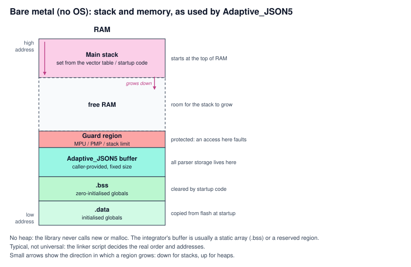
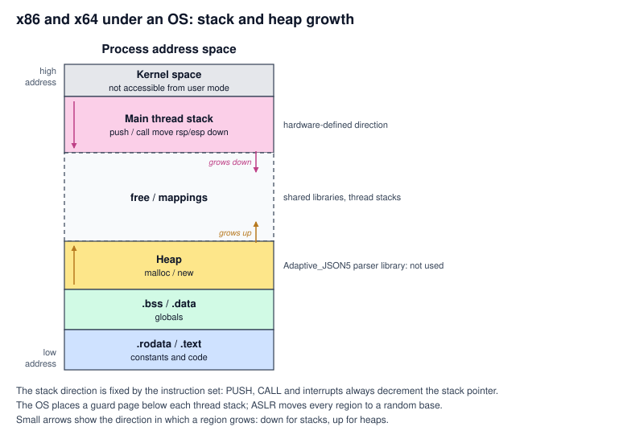
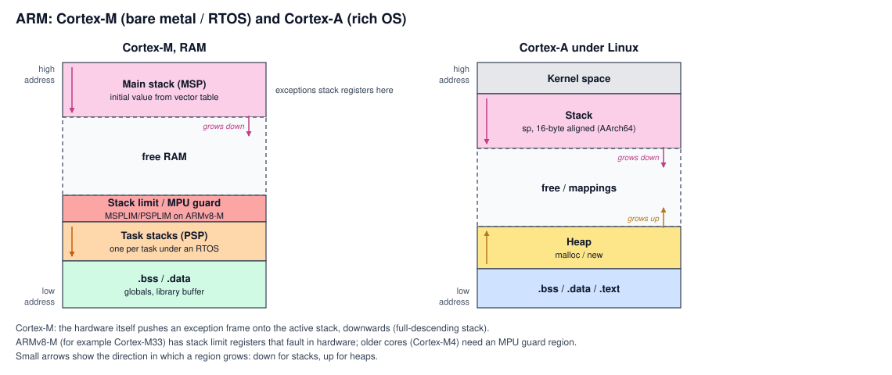
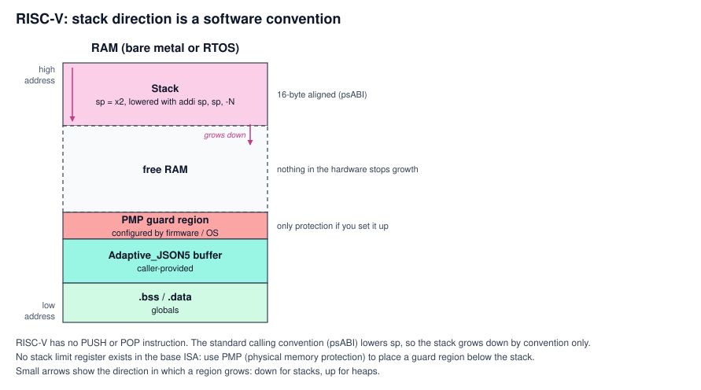
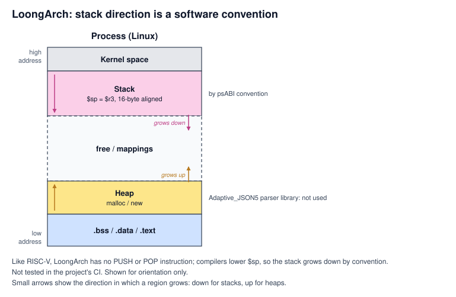

# Cybersecurity assumptions

| Item | Value |
| --- | --- |
| Work product | Assumptions for developing the library as a cybersecurity component out of context (ISO/SAE 21434) |
| Issue | [#139](https://github.com/Romanr92/Adaptive_JSON5/issues/139) |
| Status | Draft, not reviewed. The owner discussion is still in progress. |
| Scope | Parser library `AdaptiveJSON5::parser`. The hosted add-on and the planned serializer are not covered yet. |

The library is developed without knowing the vehicle, the ECU or the network it will
be used in, in the same way as for functional safety (see the
[SEooC assumptions](../ISO26262-safety/seooc-assumptions.md)). The full threat
analysis and risk assessment (TARA) of the item, with damage scenarios and impact
ratings, is done by the integrator at vehicle level. This document records what the
library assumes instead. The integrator must confirm each assumption against their
own item and their own TARA.

No compliance, certification or "secure" status is claimed in this document.

## CA-01 Attacker model

- **The attacker fully controls the JSON input.** Every byte, its length and its
  timing can be chosen by the attacker, for example by sending crafted messages over
  Ethernet or another vehicle network. This matches the safety assumption that all
  input is untrusted ([A-03](../ISO26262-safety/seooc-assumptions.md#a-03-all-input-is-untrusted)).
- **The attacker cannot change the library's code or memory directly.** If an attacker
  could already write to the ECU's memory or replace its software, the library could
  not defend itself. Preventing that is the integrator's job, for example with secure
  boot, signed software updates and memory protection.
- **The library's memory is bounded.** The library never uses the heap. All its storage
  comes from the buffer or memory functions the integrator provides, plus the call
  stack, and every resource is capped by the integrator's limits
  ([A-04](../ISO26262-safety/seooc-assumptions.md#a-04-the-integrator-sets-the-resource-limits),
  [A-05](../ISO26262-safety/seooc-assumptions.md#a-05-memory-no-heap-and-which-library-is-which)).
  A whole class of attacks therefore does not apply: there is no heap metadata to
  corrupt and no way to make the library take more memory than it was given.
- **Deep nesting cannot exhaust the stack through recursion.** The parser keeps open
  containers on an explicit stack in the caller's buffer instead of using recursion.
  The real stack use is still to be measured (#136).

## CA-02 What the attacker wants

Ordered from most to least serious:

| ID | Goal | Example at the library boundary |
| --- | --- | --- |
| G-1 | **Take control** | Use a memory bug such as a buffer overflow to write outside the library's buffer, corrupt other data, or run the attacker's own code. From there the attacker could reach other parts of the ECU. |
| G-2 | **Break integrity** | Make the library accept bad or tampered data as valid, or make two parsers read the same message differently. |
| G-3 | **Break availability** | Make the library hang, crash, run too long, or reject valid data. |
| G-4 | **Break confidentiality** | Make the library leak memory contents, for example through error messages or retained copies of the input. |

G-1 is the top threat. The defences line up with the safety work: the library never
writes outside the memory it was given
([SSR-08](../requirements.md#k-software-safety-requirements-iso-26262)), fuzzing and
sanitizers hunt for exactly these bugs
([verification strategy](../ISO26262-safety/verification-strategy.md)), and memory
protection on the integrator's side keeps an overflow from spreading
([DFA-04](../ISO26262-safety/software-safety-analysis.md#2-dependent-failure-analysis)).

## CA-03 How memory is laid out, and why it matters

A memory bug is only dangerous because of what lies next to the memory it touches.
This section explains, per architecture, where the stack and the heap are and in
which direction they grow, so that integrators can place guard regions correctly.
The pictures show normal operation only.

**Caveat: this depends on the architecture, the operating system and the linker
script.** The pictures show the usual layout, not a guarantee. What every label in
the pictures means (`.text`, `.rodata`, `.data`, `.bss`, heap, stack, guard region,
MPU, PMP and so on) is explained in the
[legend of the memory layout reference](../memory-layout.md#legend-what-every-label-means),
together with the layout per operating system.

The classic picture: the stack starts at a high address and grows **down**, the heap
starts lower and grows **up**, so they grow toward each other. Adaptive_JSON5 itself
uses no heap: only the integrator's buffer and the stack.

### Bare metal (no operating system)

- This is the most important case for the library: a microcontroller with no
  operating system, or a small RTOS, and usually **no heap at all**.
- Startup code sets the stack pointer, typically to the top of RAM, and the stack
  grows down from there.
- Below the stack there is usually static data: global variables in `.bss` and
  `.data`, and often the Adaptive_JSON5 buffer as a static array.
- **Without memory protection, nothing stops the stack at its end.** It would silently
  continue into the global data below it. The integrator must place a guard region
  below the stack: an MPU region, a PMP region on RISC-V, or the stack limit registers
  on ARMv8-M.

### x86 and x64

- The stack grows down, and **the hardware enforces this direction**: `PUSH`, `CALL`
  and interrupt entry always lower the stack pointer (`esp` or `rsp`).
- Under an operating system the heap sits lower and grows up. Every thread gets its
  own stack with a guard page below it.
- Address space layout randomization (ASLR) moves the stack, heap and libraries to a
  random base on every start, which makes memory bugs much harder to exploit.

### ARM

- The stack grows down. On **Cortex-M**, the hardware itself pushes registers onto the
  active stack on every interrupt, downwards, and the initial stack pointer comes from
  the first entry of the vector table, usually the top of RAM.
- **ARMv8-M cores** (for example Cortex-M33) have stack limit registers, `MSPLIM` and
  `PSPLIM`, that raise a fault when the stack goes past its limit.
- **Older cores** such as the Cortex-M4 have no stack limit registers and need an MPU
  guard region below each stack.
- **Cortex-A** under Linux uses the usual process layout; on AArch64 the stack pointer
  is kept 16-byte aligned.

### RISC-V

> **⚠️ RISC-V gives the least built-in help.** This is the main target for the
> library, so read this one carefully.

- RISC-V has **no push or pop instructions**. The stack pointer is simply register
  `x2` (`sp`), and functions lower it themselves (`addi sp, sp, -N`).
- The direction is therefore **only a software convention**: the standard calling
  convention (psABI) has the stack grow down and keeps `sp` 16-byte aligned. Nothing
  in the hardware enforces that direction.
- **Nothing in the hardware catches an overflow either.** The base ISA has no stack
  limit register. Protection comes from **PMP (physical memory protection)**, set up by
  the firmware or OS as a guard region below each stack. If nobody configures it,
  there is no protection.

### LoongArch

- LoongArch, from Loongson, works much like RISC-V here: **no push or pop
  instructions**, the stack pointer is register `$r3` (`$sp`), and the standard
  calling convention (psABI) has the stack grow down with 16-byte alignment. The
  direction is a convention, not something the hardware enforces.
- It is mostly used in desktop, server and industrial systems, usually under Linux.
- **Not tested in the project's CI.** This section explains the memory layout only; it
  does not claim that the library has been verified on LoongArch.

## CA-04 Supply chain: the second way in

At run time the parser library has no dependencies, so the input is the only way in.
At build time there is a second one: the tools and data the library is built from.

| Entry point | Risk | Planned protection |
| --- | --- | --- |
| Unicode data used to generate `unicode_tables.hpp` | Tampered data changes how characters are classified | Pinned version and checksum; tables checked by unit tests |
| CI actions and runners | A compromised action changes what is built or released | Actions pinned to a full commit, least-privilege tokens (#131) |
| Compiler and toolchain | A compromised compiler adds hidden code ("Reflections on Trusting Trust") | A blocking second compiler (#141); see [tool confidence](../ISO26262-safety/tool-confidence.md#4-reflections-on-trusting-trust) |
| Release packages | A replaced archive reaches integrators | Checksums, an SBOM and signed releases (#131) |
| GoogleTest (tests only) | A compromised test framework hides failures | Pinned commit; never linked into the library; self-check (#142) |
