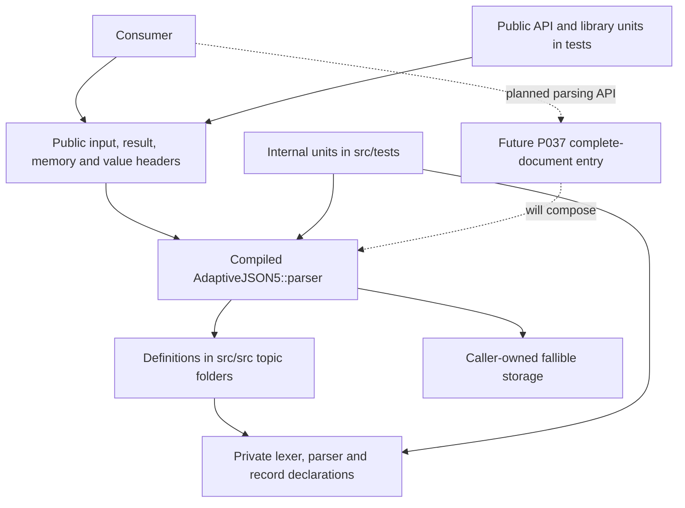

# Architecture and implementation boundaries

Updated after the compiled-library refactor, commit `61c98a3`. This page describes
current components and their contracts. See the [source layout guide](source-layout.md)
for exact folders, [ADR 0002](adr/0002-public-private-source-layout.md) for the
layout decision, and the [detailed architecture diagrams](current-architecture.md)
for class inventories, state transitions and the intended M1 endpoint.
The active [requirements](requirements.md) remain authoritative; source presence,
passing units and full requirement verification are distinct.

## Current implementation and remaining boundary

The core is a compiled C++17 static library, exported as `AdaptiveJSON5::parser`.
It contains explicit result/error handling, bounded input access, Unicode and
lexical components, owned document/value storage, resource guards, primitive
parsing and the internal iterative P033 container engine.

The public `parse_document()` entry now parses one complete document, including
mode-valid trailing trivia, and rejects missing roots or invalid suffixes. The
internal P033 engine remains prefix-oriented and private. P034/P035 container
handling, P036 duplicate policy and the P037 public entry have implementation and
host-unit evidence; their requirement rows remain Draft pending full acceptance
and conformance. Checked numeric operations and expanded diagnostic evidence are
later stages. These features followed, rather than being part of, the refactor.

| Boundary | Current responsibility | Exposure |
| --- | --- | --- |
| Public input/results/options | Explicit bytes and length, syntax/limits, inline success/error outcomes | Supported headers under `includes/adaptive_json5/` |
| Public memory/value API | Caller storage, owned blocks/strings/number spellings, documents, views, iteration and lookup | Public topic headers; ordinary bodies compiled into the library |
| Character/lexical processing | Cursor, Unicode, trivia, escapes, token recognition and boundaries | Private declarations under `src/includes/adaptive_json5/detail/` |
| Parser orchestration | Shared budgets, bounded frames, open/close/attach/state dispatch | Internal engine and helpers; ordinary bodies in `src/src/parser/` |
| Consumer API units | Public-header compilation and behavior through supported interfaces | Top-level `tests/`, with no private include path |
| Internal component units | Lexers, guards, frames, engine and private record operations | `src/tests/`, with private include access |

## Header and source responsibilities

The component root `src/` contains three separate trees: `includes/` for private
headers, `src/` for compiled implementations, and `tests/` for internal units.
The repository root `includes/` is the supported consumer-header root. Only that
public tree is installed. CMake exposes it publicly and adds the private tree
only to the core and internal units. Production sources are explicit lists,
never a recursive glob that could absorb test code.

| Example declaration | Matching implementation |
| --- | --- |
| `includes/adaptive_json5/value/document.hpp` | `src/src/value/document.cpp` |
| `includes/adaptive_json5/memory/accounted_storage.hpp` | `src/src/memory/accounted_storage.cpp` |
| `src/includes/adaptive_json5/detail/parser/parser_engine.hpp` | `src/src/parser/parser_engine.cpp` |
| `src/includes/adaptive_json5/detail/lexer/scalar_lexer.hpp` | `src/src/lexer/scalar_lexer.cpp` |

Class headers retain required layout and function declarations. Ordinary method
bodies, constructor initializer lists and non-template free-function definitions
belong in the corresponding `.cpp`. Each source includes its declaration header
first, then its implementation dependencies. Default arguments belong on the
header declaration; definitions preserve the namespace, signature and `noexcept`.
Helpers used by only one source may have translation-unit-local linkage.

Public templates such as `result<T, E>` and definitions needed for constant
evaluation remain visible in headers. Private Unicode templates and generated
immutable tables remain private header facilities. These exceptions do not make
the parser header-only. Forward declarations are appropriate for some borrowed
pointer/reference types; by-value data members require complete types.

Teaching and reviews must follow these boundaries. Inspect the header, matching
source and CMake entry before guidance. Present declaration/definition pairs
when the change needs both; do not put ordinary implementation into a header to
simplify a lesson. Explain translation units and linking alongside the learner's
current C++ concepts. Preserve the existing allocation strategy instead of adding
PImpl, virtual dispatch or other abstractions without a concrete requirement.

## Input, syntax and explicit results

`input_view` borrows immutable caller bytes with an exact length. No terminating
NUL is needed, and embedded zero is not EOF. A null pointer is valid only with
zero length; readable memory and lifetime remain caller preconditions. A cursor
copies that description and bounds every read/advance.

Transactional recognizers work on a cursor copy and commit it after recognition
succeeds. `result<std::optional<T>>` distinguishes failure, successful no-match
and a successful token. The parser turns no-match into syntax failure where a
value/name is required. Helper atomicity is local: a failed engine may contain
private partial work and must be discarded rather than rerun.

`parse_options` owns syntax selection and finite resource limits. JSON5 is the
default, with explicit strict JSON selection. Both mode paths exist in lexical
and internal structural operations; no full language-conformance claim follows.
The future P037 entry must admit exactly one root plus permitted surrounding
trivia, rejecting empty input, extra roots and trailing nontrivia.

## Owned records and borrowed access

`document` owns a flat sequence of records plus a root index. Each record stores
one null/Boolean/string/number/array/object payload and optional member-name and
source-span metadata. Arrays/objects retain ordered child indices; child records
supply parent and next-sibling indices. They do not recursively own descendants.
Destruction iterates records and releases their own allocations without walking
a recursively owned tree.

The public document header contains the supporting `detail::value_storage`
declaration needed by its by-value member. Record/payload definitions and storage
method bodies are private. Direct consumer use of that supporting declaration
is not a supported API. This choice preserves allocation-free document
construction and existing layout without opaque-state allocation.

`value_index` identifies a record position within its originating document; it
does not encode owner identity. Appending preserves indices but may relocate
records. Views reacquire records by index. Accessor-returned pointers can be
invalidated by record growth; moving/destroying the owner invalidates existing
views and iterators. Reacquire views from the moved-to document. Do not change
relationships during iteration. Repeated indexed enumeration is linear per
lookup; use an iterator to avoid quadratic total traversal.

Strings/names own counted UTF-16 units, including NUL and lone surrogates.
Checked UTF-8 export rejects invalid scalar sequences rather than replacing them.
Numbers own original validated spelling and family without eager machine-number
conversion. Exact comparison and requested integer/floating conversions remain
separate later work.

The model preserves every duplicate member in source order. Lookup reports
absent, unique or ambiguous rather than choosing a duplicate silently. Name
equality uses exact decoded units without normalization or case folding. P036's
explicit parser rejection policy and reporting of both occurrences remain pending;
`parse_options` does not yet expose that policy.

## Iterative parsing and resource ownership

The internal engine owns a private candidate document, cursor, frame stack,
logical resource budget, work budget and retained warning summary. Opening a
container reserves value/member and depth resources before frame/record growth.
Closing validates punctuation/state, records the span, pops the frame, releases
depth and accepts the completed value. Completion attaches to the waiting parent
or records the root when no parent remains. Parent frame pointers are reacquired
after stack mutations.

Container mutual nesting uses explicit frames rather than recursive C++ calls.
A frame temporarily owns an object's pending decoded name until attachment.
Frame/record growth uses aligned fallible blocks and nonthrowing moves; old/new
capacity overlap is included in byte accounting. Cleanup requires neither new
allocation nor additional work-budget admission.

Three mechanisms serve different purposes:

| Mechanism | Resource tracked |
| --- | --- |
| `resource_budget` | Logical nodes/members, simultaneous depth, retained decoded units/diagnostics, input and numeric bounds |
| `work_budget` | Cumulative deterministic phase allowances, charged before the associated work |
| `accounted_storage` | Simultaneously outstanding requested bytes, including capacity and growth overlap; upstream provider overhead excluded |

Limits are inclusive and finite; zero permits zero consumption and is not an
unlimited sentinel. Defaults and units are documented in
[`resource_limits.hpp`](../includes/adaptive_json5/memory/resource_limits.hpp)
and the [detailed resource map](current-architecture.md#3-storage-ownership-and-budgets).
Failed reservations preserve their counters; successful work charges are not
refunded after later failure. Shared whole-tree accounting must include both
names and string values. These allowances are not elapsed-time measurements or
a demonstrated real-time bound. Cross-component completion remains under #69.

Owned objects retain storage callbacks, not ownership of the provider context.
The caller-owned accounting adapter must remain at a stable address and, with
its upstream provider state, outlive all allocations moved into returned data.
A returned document owns its contents independently of source bytes, but does
not extend those external provider lifetimes.

## Failure, runtime and concurrency boundaries

All recoverable library failures use explicit `result`/`error` outcomes in both
exception modes. Minimal errors contain a stable category and optional original
byte location without allocating. Byte zero differs from absent location; EOF
locations use the valid end offset. Ordinary invalid input must not throw,
assert or abort. Unsupported throwing provider behavior is not a recoverable
allocation strategy.

| Category | Current implementation boundary |
| --- | --- |
| `syntax` | Lexical, primitive and internal engine errors; unified entry still pending |
| `encoding` | Checked Unicode decoding/export and composed parsing paths |
| `wrong_type_or_access` | Checked value/storage access and invalid descriptions/state |
| `resource_limit` | Logical, work or owned-byte ceiling exhaustion |
| `allocation_failure` | Caller provider cannot fulfill a request |
| `duplicate_policy` | Category exists; P036 parser rejection remains pending |
| `numeric_conversion` | Category exists; P038 checked conversion remains pending |

Failure returns no successful partial tree. Private temporaries release storage
when their owners are destroyed. Rich diagnostics remain separate from minimal
allocation-free error reporting. Existing value spans and warning summaries do
not establish all later P039 diagnostic/member-name-span requirements.

The generic core performs no filesystem, process, network, environment, clock,
locale or OS-thread operations. Separate contexts/documents have no required
shared mutable global state; shared mutable providers/adapters require caller
synchronization. No OS locks, default global heap, RTTI or exception-dependent
recovery are introduced. The [embedded boundary](embedded.md) states target
preconditions; host units do not establish device execution or certification.

Optional schema, CLI, editor and consumer adapters remain separate components.
Schema loading, host I/O and consumer rejection policies must not enter pure
core operations. Schema/reference/numeric semantics and any dependencies remain
subject to their own requirements and provenance decisions.

## Verification and remaining work

The refactor preserved the existing executable logic and all original units.
All 20 public headers compile separately without private include access. The
full local suite passed **1422/1422 cases in both exception modes**, RTTI OFF,
with 32 parallel workers; formatting and tests-disabled build/install also passed.
See [verification notes](verification.md) for exact scope and source-review evidence.

Remaining work includes P034/P035 grammar acceptance, P036 duplicate policy,
P037 complete-document entry, later numeric operations and diagnostic expansion,
whole-grammar evidence/full-support review, and independently tracked optional
components and cross-component runtime accounting. The layout and passing units
do not promote Draft J5 contracts or imply unexecuted compiler/CI/device results.
