# Current parser architecture

Updated after the 2026-10-19 structural refactor. P033's internal engine is
implemented and has unit evidence; P034?P037 remain separate work. Public headers
now live under `includes/`, private headers under `src/includes/`, implementations
under topic folders in `src/src/`, and internal units under `src/tests/`. Public API
and library-behavior units remain under top-level `tests/`.

[ADR 0002](adr/0002-public-private-source-layout.md) records the accepted layout
and its implementation. The descriptions below distinguish current internal
components from the M1 endpoint. Source existence and unit evidence do not promote
J5 Draft contracts to Verified; see [verification notes](verification.md).

The active [requirements](requirements.md), [traceability](traceability.md),
[implementation sequence](requirements/json5-implementation-order.md),
[scope ADR](adr/0001-project-scope.md) and [embedded boundary](embedded.md)
remain authoritative. This is an explanatory architecture map, not a change to
their contracts or statuses. Existing [architecture contracts](architecture.md)
include historical preparation-stage descriptions; use this snapshot for the
current source inventory.

## Reading the diagrams

In class diagrams, `*--` means ownership/composition, `-->` means a reference or
relationship without ownership, and `..>` means a dependency or call. An owned
optional or variant alternative exists only when selected. Function modules are
marked `<<module>>`: they are groups of free functions, not C++ classes.
Namespace prefixes are omitted in diagrams for readability; internal types are
identified as `detail::` in the descriptions. Methods shown are representative,
not complete API declarations. Proposed types are explicitly marked.

## 1. Layers and current implementation boundary

### Complete picture now

This overview combines the existing components into one picture. Solid arrows
show current collaboration or ownership. The remaining-work box marks the
unfinished M1 steps; P033 engine composition is now implemented. Detailed class diagrams later
in this document explain the individual types.

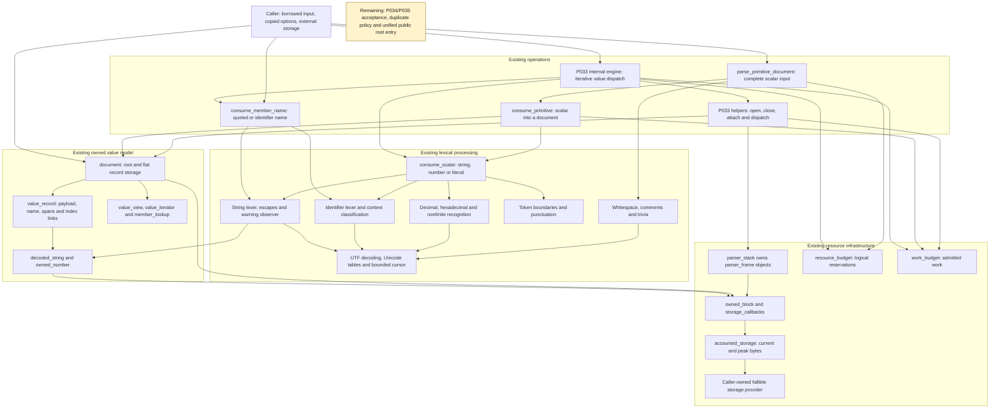

The storage arrows show the accounted-provider route used by parsing and intended
for engine composition. Individual low-level components can receive plain
`storage_callbacks`; they do not force the adapter themselves. The whole library
uses explicit `result`/`error` outcomes across these layers, omitted from the
arrows to keep the picture legible.

### Complete picture at the end of M1

The current live [issue #38](https://github.com/Romanr92/Adaptive_JSON5/issues/38)
defines **Milestone 1: First Working JSON5 Parser**, ending at P037. Its preceding
container work is [issue #33](https://github.com/Romanr92/Adaptive_JSON5/issues/33),
P033–P036. This live split supersedes the older roadmap table that still groups
P037–P042 under #38. [Issue #80](https://github.com/Romanr92/Adaptive_JSON5/issues/80)
assigns P038–P041 to M2. Scope checked on 2026-10-19; this document does not change
issue assignments or milestone definitions.

The M1 endpoint is one complete JSON5 input becoming an owned, inspectable
document, or an explicit failure. The diagram below is the intended completed
architecture, not a claim that those connections exist today. Labels describe
responsibilities; final entry-point and policy type names are still to be chosen.

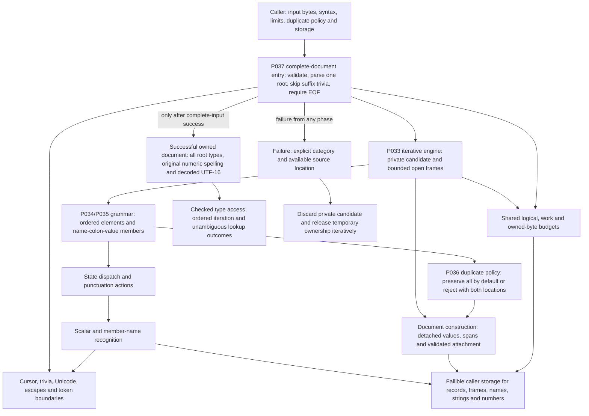

### M1 class collaboration overview

Existing types retain their current names. `CompleteDocumentEntry` and
`DuplicatePolicy` below are conceptual roles rather than proposed C++ signatures.
`parser_engine` is implemented as an internal operation object. Dependencies on a shared budget mean
explicit caller integration, not automatic enforcement by every accessor.

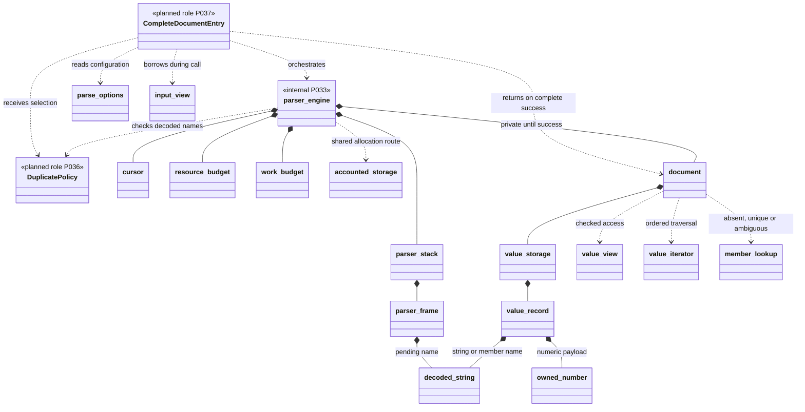

| Capability | Current snapshot | Required M1 endpoint |
| --- | --- | --- |
| Lexical foundation | UTF, trivia, strings, identifiers, numbers and scalar dispatch present | Composed into whole-tree parsing with their existing mode/limit contracts |
| Owned values | Flat document, links, strings, number spelling and checked views present | Parsed roots of every supported kind retain their owned content |
| Scalar root | Complete primitive-only entry exists | Same scalar capability through the unified document entry |
| Arrays and objects | Frames, dispatch, opening, closing, name recognition and attachment helpers exist | Working bounded engine with empty/mixed nesting and complete element/member states |
| Duplicates | Document preserves occurrences and lookup reports ambiguity | Explicit preserve/reject parser policy with exact decoded comparison and both collision locations |
| Complete input | Enforced for primitive-only documents | One root of any type, surrounding trivia, rejection of empty input, extra roots and trailing nontrivia |
| Resource control | Guards and byte adapter exist, some component paths composed | Shared budgets integrated into the M1 parsing paths, including names, nesting, failure and cleanup |
| Error result | Explicit categories and component source offsets exist | Parse failure publishes no successful partial document and releases temporary resources |
| Evidence | Component implementation is distinct from executed evidence | M1-owned units and required formatting pass before milestone completion is claimed |

M1 does not mean the entire project is finished. Checked numeric conversion and
exact comparison (P038), expanded document/diagnostic contracts (P039), the
whole-grammar evidence matrix (P040) and the full-support claim review (P041)
remain later work under #80. P042 and optional schema, CLI/editor, package and
cross-component runtime completion remain separately tracked. Existing strict
mode behavior must be preserved as the parser is composed; this endpoint does
not move P042's final strict-mode work into M1 or certify language conformance.

### Layer detail

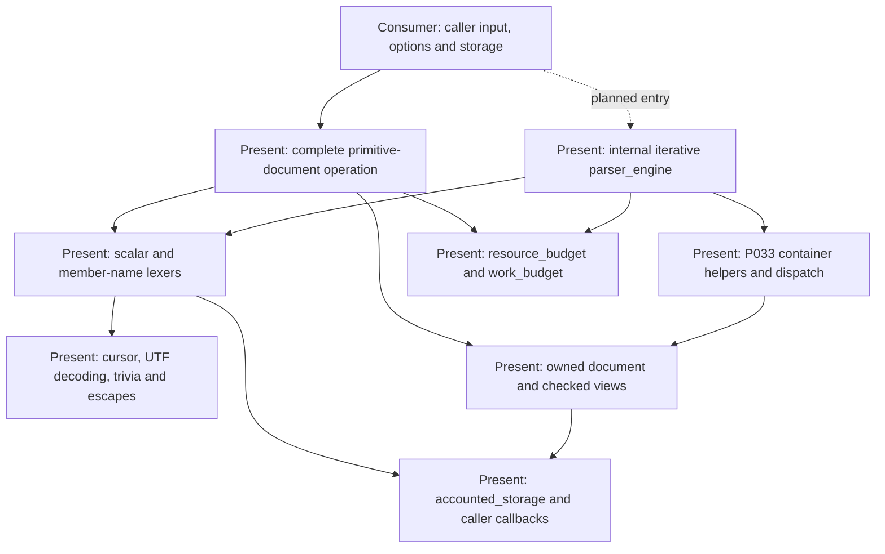

Ordinary non-template implementations now compile into a static library. Lexical recognition, owned
values, storage and accounting are separate components. P033 joins arrays
and objects through a shared iterative engine. Its internal prefix result is
not the future public complete-document parser API.

`parse_primitive_document()` already handles a complete scalar root, including
leading/trailing trivia and suffix rejection. It cannot parse an array or object
root. The unified complete-document entry point belongs to P037. P034/P035
complete the array/object grammar work; P036 adds explicit duplicate rejection.
Exact spelling storage exists, but later checked numeric operations remain
distinct from recognition and storage.

Schema, CLI, editor and consumer adapters remain outside this core map. Their
optional dependencies must not become parser runtime dependencies. The core
uses in-memory input, C++17 facilities and caller storage; no OS service or
implicit global heap is part of its contract.

## 2. Input, configuration and explicit outcomes

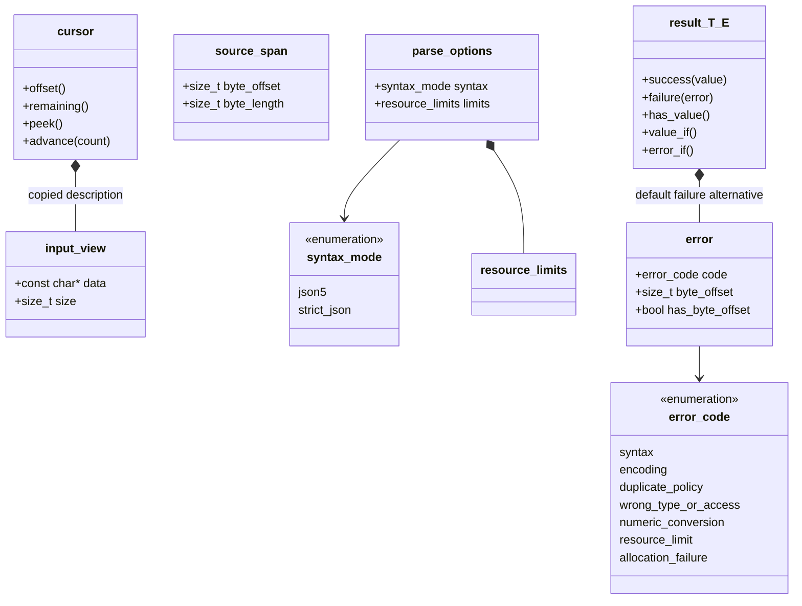

| Type / header | Responsibility and interaction |
| --- | --- |
| [`input_view`](../includes/adaptive_json5/input.hpp) | Borrowed bytes plus exact length. Does not own or validate caller memory. No terminating NUL is needed; an embedded zero remains an input byte. |
| [`source_span`](../includes/adaptive_json5/input.hpp) | Copyable original byte offset and length. Describes a range without retaining its text. |
| [`cursor`](../src/includes/adaptive_json5/detail/input/cursor.hpp) | Holds a borrowed input description and current position. Bounded access distinguishes EOF from a zero byte. Copying a cursor enables speculative recognition. |
| [`syntax_mode`, `parse_options`](../includes/adaptive_json5/options.hpp) | Select JSON5 by default or strict JSON explicitly; options also own the resource-limit configuration. Configuration alone enforces nothing. |
| [`result<T, E>`](../includes/adaptive_json5/result.hpp) | Stores success or error inline; default error type is `error`. Checked pointer access avoids throwing alternative access. Supports move-only payloads subject to its nonthrowing constraints. |
| `result<void, E>` / `status_result` | Success has no payload. `status_result` is the alias used by fallible operations that return only status. |
| [`error`, `error_code`](../includes/adaptive_json5/error.hpp) | Minimal allocation-free failure category and optional original byte location. Offset zero and absence of a location are distinct. |

Recognizers commonly return `result<std::optional<T>>`: failure means malformed
input or an operational error, successful empty optional means no match, and a
successful populated optional means a recognized token. No-match is not an
error. Transactional recognizers advance a private cursor and commit it only
after successful recognition; inspect each helper's contract rather than
assuming all higher-level operations roll back a document.

## 3. Storage, ownership and budgets

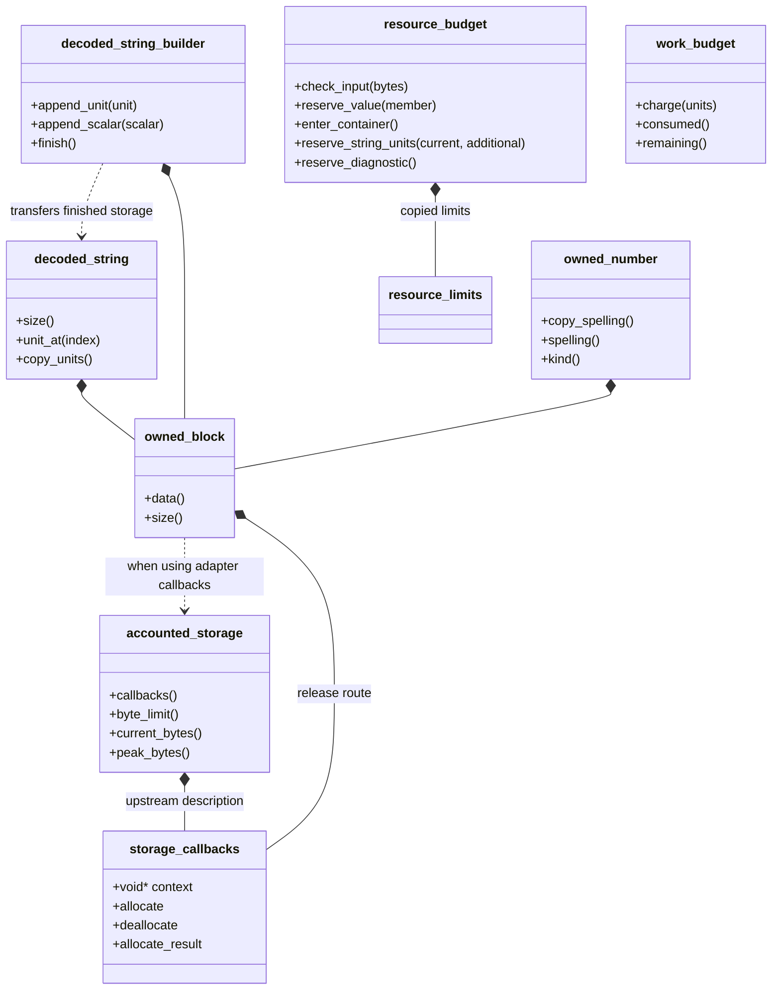

| Type / header | Responsibility and interaction |
| --- | --- |
| [`storage_callbacks`](../includes/adaptive_json5/memory/storage.hpp) | Borrows provider context and function pointers. A usable provider supplies deallocation and an allocation route. Explicit-result allocation takes precedence over pointer-or-null allocation. The context remains caller owned. |
| `allocate_function`, `allocate_result_function`, `deallocate_function` | Callback aliases, not allocator objects. Requests carry byte count and alignment; release must match the original request and must not allocate or throw. |
| [`owned_block`](../includes/adaptive_json5/memory/owned_block.hpp) | Move-only owner of one raw allocation and its release description. Destruction releases it once through the original provider. `allocate_block()` and `allocate_array()` validate requests and checked sizes. |
| [`accounted_storage`](../includes/adaptive_json5/memory/accounted_storage.hpp) | Wraps an upstream provider with a ceiling on simultaneously outstanding requested bytes. Exposes callbacks and current/peak counters. Capacity and old/new overlap during growth count; upstream internal overhead does not. |
| [`decoded_string`](../includes/adaptive_json5/value/decoded_string.hpp) | Immutable owned UTF-16 units, including embedded NUL and unpaired surrogates. Move construction transfers ownership; copy and move assignment are deleted. |
| [`decoded_string_builder`](../src/includes/adaptive_json5/detail/memory/decoded_string_builder.hpp) | Bounded mutable decoding buffer. Appends units or encoded scalars, then transfers storage through `finish()`. An unfinished builder releases its storage. |
| [`owned_number`](../includes/adaptive_json5/value/owned_number.hpp) | Owns validated original spelling and its numeric family. Keeps huge finite spellings and special spellings without rounding through a machine floating type. This is not the later numeric conversion API. |
| [`resource_limits`](../includes/adaptive_json5/memory/resource_limits.hpp) | Inclusive finite limits. Zero permits zero consumption; there is no unlimited sentinel. |
| [`resource_budget`](../src/includes/adaptive_json5/detail/memory/resource_budget.hpp) | Tracks node/member, depth, decoded-unit and diagnostic reservations; checks input and number bounds. Failed reservations preserve counters. Matching release operations support rollback. Does not allocate storage or charge work. |
| [`work_budget`](../src/includes/adaptive_json5/detail/memory/work_budget.hpp) | Cumulative deterministic work allowance. Failed charges leave consumption unchanged; successful charges are retained after later failure. Does not measure elapsed time or establish a real-time guarantee. |

The three accounting mechanisms are complementary: `resource_budget` counts
logical resources, `accounted_storage` counts allocation bytes, and
`work_budget` counts admitted work. Constructing any of them does not
automatically integrate its accounting into other components.

Current defaults in `resource_limits.hpp`:

| Limit | Default | Unit |
| --- | ---: | --- |
| `max_input_bytes` | 16384 | Complete supplied input bytes |
| `max_depth` | 64 | Simultaneously open arrays/objects |
| `max_nodes` | 1024 | All values, including root and containers |
| `max_members` | 1024 | Object members across the document |
| `max_string_units` | 4096 | UTF-16 units per string/name |
| `max_total_string_units` | 16384 | UTF-16 units across strings/names |
| `max_number_bytes` | 1024 | Bytes per numeric spelling |
| `max_exponent_digits` | 128 | Digits, excluding exponent sign |
| `max_owned_bytes` | 32768 | Outstanding requested allocation bytes |
| `max_diagnostics` | 16 | Retained diagnostic entries |
| `max_work_units` | 32768 | Operation-defined charged work |

### Allocation and lifetime interaction

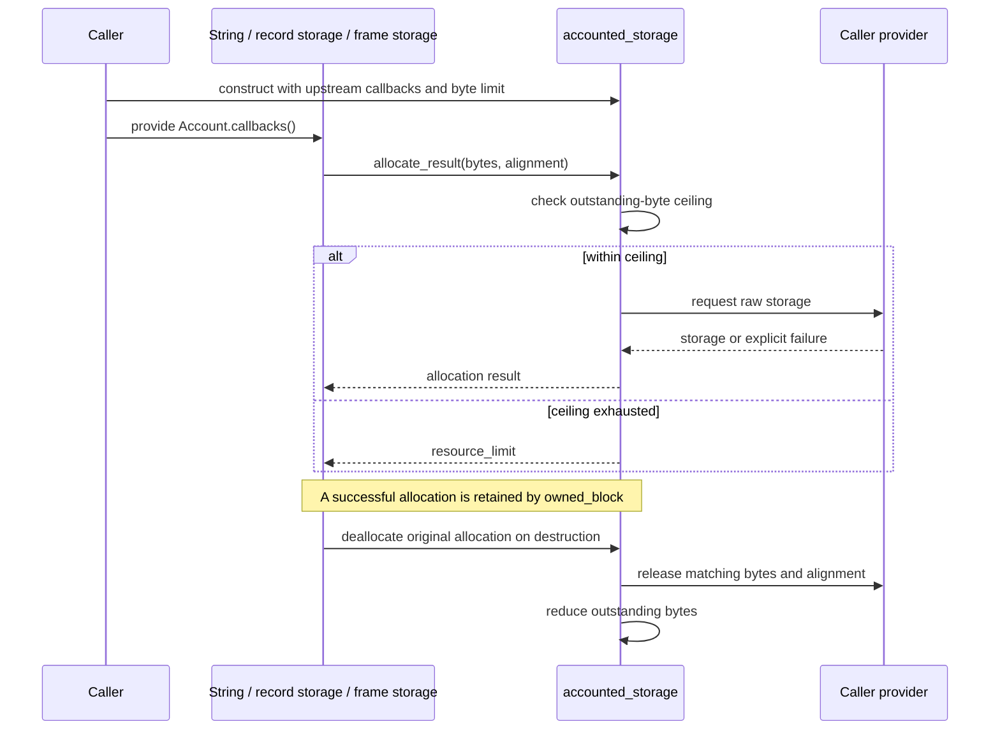

The accounting adapter's address and upstream provider state must remain valid
until every returned allocation is released, including allocations moved into a
successful document. A document owns its data, but does not own those external
provider contexts. A shared mutable adapter requires caller synchronization.

Raw storage and object lifetime are separate: record/frame growth obtains an
aligned block, constructs objects in it with placement construction, moves live
objects, and destroys the old objects before releasing old storage. Placement
construction itself is not a request to the global heap. No MISRA, CERT,
AUTOSAR or target timing compliance claim follows from this diagram.

## 4. Character processing and lexical composition

These facilities are mostly free functions, not a hierarchy of lexer classes.

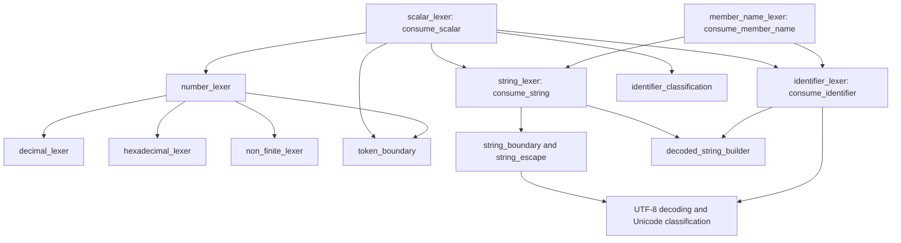

Arrows group functional collaboration; they do not enumerate every include.
The name recognizer tries a quoted string, then a JSON5 identifier when permitted
by the selected mode. It does not reinterpret member names as literal values.
The scalar dispatcher recognizes strings, number families and admitted literals;
an arbitrary identifier is not implicitly a string value.

### Lexical data types

| Type / header | Purpose and ownership |
| --- | --- |
| [`decoded_character`](../src/includes/adaptive_json5/detail/unicode/utf8.hpp) | One Unicode scalar plus original UTF-8 byte span; owns no text. |
| [`unicode_range`](../src/includes/adaptive_json5/detail/unicode/unicode_range.hpp) | Inclusive interval used by sorted Unicode property tables. `unicode.hpp` queries the tables in `unicode_tables.hpp`. |
| [`encoded_utf16`](../src/includes/adaptive_json5/detail/unicode/utf16.hpp) | Inline one- or two-unit encoding of a Unicode scalar; no allocation. |
| [`decoded_utf16`](../src/includes/adaptive_json5/detail/unicode/utf16_decode.hpp) | One scalar decoded from stored units and the number of units consumed; unpaired surrogates fail checked scalar decoding. |
| [`whitespace_span`](../src/includes/adaptive_json5/detail/lexer/whitespace.hpp) | Original range consumed as whitespace. |
| [`line_terminator_span`](../src/includes/adaptive_json5/detail/lexer/line_terminator.hpp) | Original line-ending range; also used by line-continuation recognition. |
| [`comment_span`](../src/includes/adaptive_json5/detail/lexer/comment.hpp) | Original consumed comment range. Comment text is not retained as document data. |
| [`trivia_span`](../src/includes/adaptive_json5/detail/lexer/trivia.hpp) | Combined whitespace/comment run. Strict mode rejects comment openers. |
| [`punctuation_kind`, `punctuation_token`](../src/includes/adaptive_json5/detail/lexer/punctuation.hpp) | Classify six structural punctuation bytes and retain the recognized byte span. |
| [`string_quote`](../src/includes/adaptive_json5/detail/lexer/string/string_boundary.hpp) | Opening delimiter selection: single or double quote. |
| `string_piece_kind`, `string_piece` | Classify a source character, closing quote or escape start; retain original scalar/span, not a reconstructed escape. |
| [`string_warning_code`, `string_warning`](../src/includes/adaptive_json5/detail/lexer/string/string_warning.hpp) | Advisory raw line/paragraph separator descriptor with original byte span; stored inline. |
| [`string_warning_observer`, `string_warning_function`](../src/includes/adaptive_json5/detail/lexer/string/string_token.hpp) | Borrowed callback/context for successful-string notifications; observer does not own warnings or input. |
| `string_token` | Owns a `decoded_string`, full quoted source span, warning count and optional first warning. |
| [`identifier_token`](../src/includes/adaptive_json5/detail/lexer/identifier/identifier_token.hpp) | Owns decoded identifier units, original span and an escape-presence flag. |
| [`identifier_context`, `identifier_classification`](../src/includes/adaptive_json5/detail/lexer/identifier/identifier_classification.hpp) | Distinguish member-name use from literal-value classification. Unrecognized value spelling is not acceptance. |
| [`number_kind`, `number_token`](../src/includes/adaptive_json5/detail/lexer/number/number_token.hpp) | Decimal, hexadecimal, Infinity or NaN family plus original byte range. The token does not own spelling bytes. |
| [`literal_kind`, `literal_token`](../src/includes/adaptive_json5/detail/lexer/scalar_token.hpp) | Null/true/false classification plus source metadata. |
| `scalar_token` | Variant of `string_token`, `number_token` or `literal_token`. Owning string alternative makes it move-only. |
| [`detail::member_name_token`](../src/includes/adaptive_json5/detail/lexer/member_name_lexer.hpp) | Common owned-name result for quoted and identifier member names; includes source range and warning summary. |

### Function modules without classes

| Headers | Responsibility |
| --- | --- |
| `utf8.hpp`, `unicode.hpp`, `unicode_range.hpp`, `unicode_tables.hpp` | Decode source bytes and query the repository's pinned Unicode property data. Decoding a scalar does not by itself admit it in a grammar position. |
| `whitespace.hpp`, `line_terminator.hpp`, `comment.hpp`, `trivia.hpp` | Recognize token separation and line structure, respecting syntax mode. Trivia is consumed between tokens, not spliced inside a token. |
| `string_boundary.hpp`, `string_escape.hpp` | Recognize delimiters/pieces and dispatch escape decoding. |
| `simple_escape.hpp`, `hex_escape.hpp`, `unicode_escape.hpp`, `non_escape.hpp`, `line_continuation.hpp` | Handle the separate escape families and continuation behavior used by string decoding. |
| `utf16.hpp`, `utf16_decode.hpp`, `utf8_export.hpp` | Encode source scalars into UTF-16; decode stored units and export checked UTF-8. Storage preserves lone surrogate units; scalar export rejects them instead of substituting. |
| `string_warning.hpp`, `string_lexer.hpp` | Preserve decoded string content and warning metadata. String observer notifications occur only after complete string recognition succeeds. |
| `identifier_lexer.hpp`, `identifier_classification.hpp` | Decode identifier spellings, then interpret their grammatical context separately. |
| `decimal_lexer.hpp`, `hexadecimal_lexer.hpp`, `non_finite_lexer.hpp`, `number_lexer.hpp` | Recognize number families and validate mode-specific token endings without eager numeric conversion. |
| `token_boundary.hpp`, `scalar_lexer.hpp`, `punctuation.hpp` | Separate token recognition from legal token termination and structural punctuation. |
| `checked_size.hpp` | Checked size addition/multiplication shared by allocation and growth operations. Overflow is an explicit failure. |
| `decoded_name_equal.hpp` | Compare exact decoded UTF-16 units, without normalization or case folding. |

## 5. Owned document model and checked access

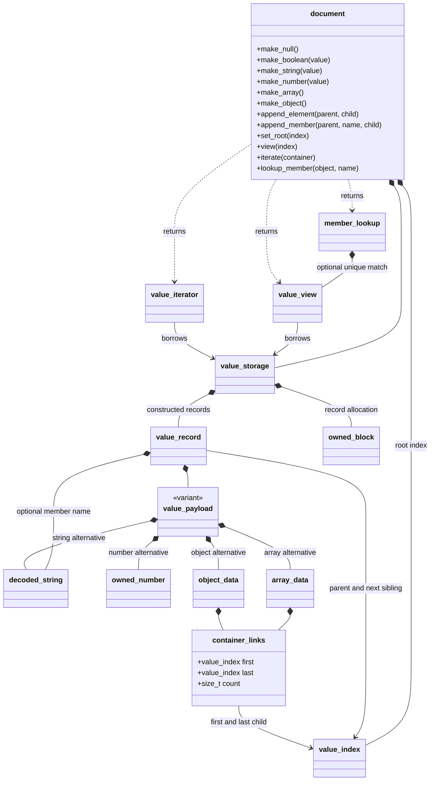

`value_payload` also has `std::monostate` for null and `bool` for booleans.
It is a variant, not a polymorphic base class: there is no virtual value hierarchy.

| Type / header | Responsibility and interaction |
| --- | --- |
| [`document`](../includes/adaptive_json5/value/document.hpp) | Owns record storage and a root index. Creates detached values, validates attachment, sets value spans/root and exposes checked access. It is a builder and owner, not a lexer. |
| [`detail::value_storage`](../includes/adaptive_json5/value/document.hpp) | Growable bounded sequence of live records in caller storage. Appending preserves existing indices; growth relocates records. Cleanup iterates records without following tree links. |
| [`detail::value_record`](../src/includes/adaptive_json5/detail/value/value_record.hpp) | One payload plus parent/sibling indices, optional owned member name, optional value span and optional member-name span. The latter is representation capacity, not evidence that the parser currently populates it. |
| `detail::value_payload` | Exactly one null, Boolean, string, number, array or object alternative. Owns scalar allocations through the selected owning type. |
| [`value_index`](../includes/adaptive_json5/value/value_index.hpp) | Set/unset document-relative record position. Does not encode document identity; the caller must not mix indices between documents. |
| [`value_kind`](../includes/adaptive_json5/value/value_kind.hpp) | Public null/Boolean/string/number/array/object classification. No type coercion. |
| [`container_links`](../src/includes/adaptive_json5/detail/value/container_links.hpp) | First/last child indices and direct-child count; owns no child records. Each child carries its next sibling. |
| `array_data`, `object_data` | Hold element/member links respectively. Source order and duplicate object names remain observable. |
| [`value_view`](../includes/adaptive_json5/value/value_view.hpp) | Borrowed storage reference plus index. Resolves checked read-only access, type queries, children, member names and value source spans. Default view is invalid, not JSON null. |
| [`value_iterator`](../includes/adaptive_json5/value/value_iterator.hpp) | Borrowed traversal state for direct children. `next()` returns a child, end-of-iteration or failure without allocating or recursively descending. |
| [`member_lookup_state`, `member_lookup`](../includes/adaptive_json5/value/member_lookup.hpp) | Explicit absent/unique/ambiguous outcome. A borrowed value is supplied only for a unique decoded-name match. |

`document_links.hpp` implements the internal `attach_child()` operation. It
checks detached-child and container invariants, prevents cycles, updates the
ordered sibling chain and moves an object name only after validation. Lookup
uses direct-child iteration plus exact decoded-name comparison; it never
silently selects the first or last duplicate.

### Why ownership is flat even though JSON is a tree

The document owns all records in one storage sequence. An array or object points
to children through indices; it does not recursively own child objects. Thus
destroying a deeply nested document destroys records iteratively. Destroying a
record releases its own string/number/name allocations without walking children.

Appending may relocate record objects. Keep `value_index` across growth, then
reacquire pointers. A `value_view` resolves its index on each access while its
storage owner remains in place; pointers returned by accessors are invalidated
by storage growth. Moving/destroying the document invalidates existing views
and iterators. Reacquire views from the destination after a move. Do not modify
relationships during iteration. Repeated `element_at()`/`member_at()` calls have
quadratic total traversal cost; prefer an iterator for enumeration.

## 6. Existing primitive parsing path

| API/type in [`primitive_parser.hpp`](../src/includes/adaptive_json5/detail/parser/primitive_parser.hpp) | Role |
| --- | --- |
| `primitive_value` | Constructed value index, original span and string-warning summary. Owns no document. |
| `primitive_document` | Owns a document plus primitive-root metadata. |
| `detail::append_primitive_token()` | Converts a recognized scalar token into a detached record. Transfers decoded strings, copies/validates numeric spelling and creates literals. Does not itself reserve aggregate resources or charge work. |
| `consume_primitive()` | Composes recognition and construction into an existing document using a supplied cursor/storage/work budget. No-match and failure preserve cursor; it does not establish the document root. |
| `parse_primitive_document()` | Validates input/configuration, constructs a private document, admits work, handles leading/trailing trivia, requires EOF, records the root span, sets root and returns ownership only on success. |

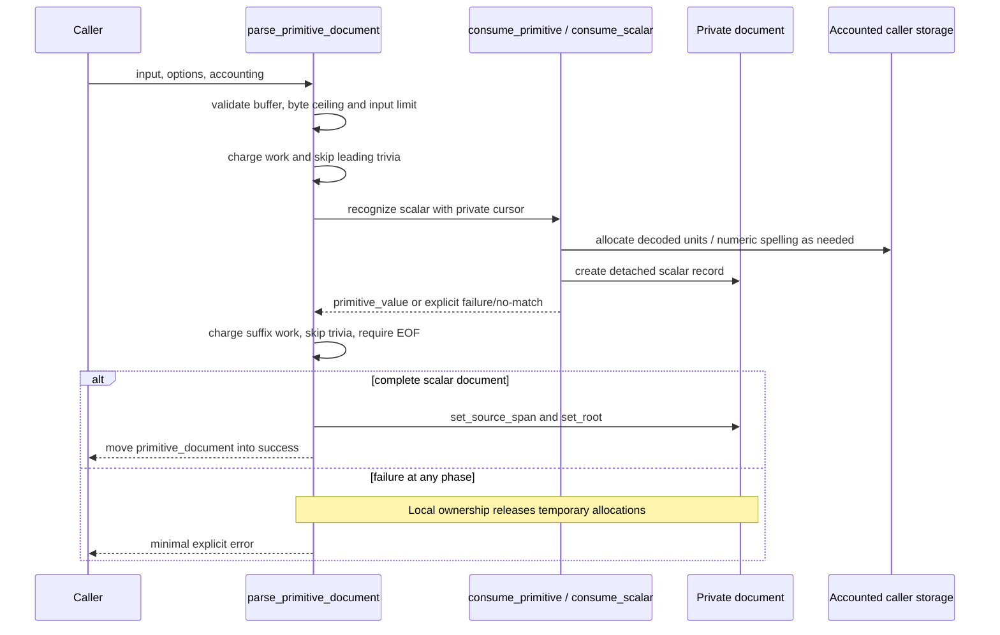

Repeated `consume_primitive()` calls do not maintain one aggregate string or
diagnostic budget across an arbitrary tree. The new engine must compose shared
operation-wide accounting; the primitive helper cannot be treated as a complete
resource integration layer for containers.

## 7. P033: iterative container helpers present now

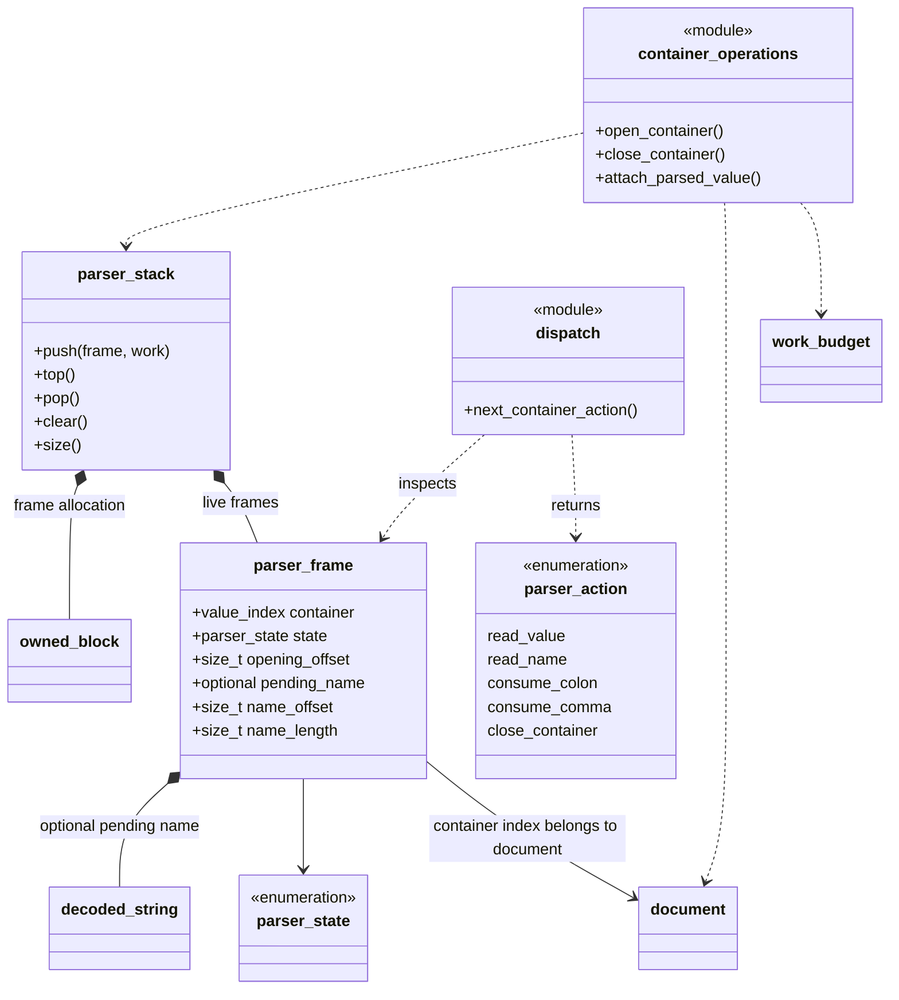

| Type / function | Responsibility, mutation and caller obligations |
| --- | --- |
| [`detail::parser_state`](../src/includes/adaptive_json5/detail/parser/parser_frame.hpp) | Eight states distinguishing array/object starts, values/names after commas, required colon/value, and comma-or-end positions. |
| `detail::parser_frame` | One open container's index, state, opening offset and optional owned pending member name with source range. Owns the name temporarily, but not the document/container. |
| [`detail::parser_stack`](../src/includes/adaptive_json5/detail/parser/parser_stack.hpp) | Bounded nonrecursive live-frame stack in fallible caller storage. Charges push/relocation work, moves frames on growth, destroys frames iteratively. Push may invalidate frame pointers; pop destroys the removed frame. |
| [`detail::parser_action`, `next_container_action()`](../src/includes/adaptive_json5/detail/parser/parser_dispatch.hpp) | Pure selection from frame state, next byte, location and mode. Does not consume input, allocate or mutate frames. Rejects missing required values and EOF inside containers. |
| [`detail::open_container()`](../src/includes/adaptive_json5/detail/parser/parser_container_open.hpp) | Pushes a provisional frame, creates a detached container record and stores its index. If record creation fails, pops the provisional frame. Caller reserves value/member and depth first, releases matching reservations after open failure, and commits the cursor after success. No attachment/root publication. |
| [`detail::close_container()`](../src/includes/adaptive_json5/detail/parser/parser_container_close.hpp) | Validates state, delimiter and span; charges work; records the completed container's span and pops its frame. Caller releases depth, advances input and accepts the returned completed value. |
| [`detail::attach_parsed_value()`](../src/includes/adaptive_json5/detail/parser/parser_attachment.hpp) | Attaches a completed child to a waiting parent, charges relationship-inspection work, transfers an object name and moves the parent to comma-or-end. Does not set the root, advance input or reserve aggregate resources. |
| [`detail::consume_member_name()`](../src/includes/adaptive_json5/detail/lexer/member_name_lexer.hpp) | Returns an owned quoted/identifier name with lexical metadata. Transactional cursor behavior; caller supplies work and aggregate budget integration. |

### Frame transitions

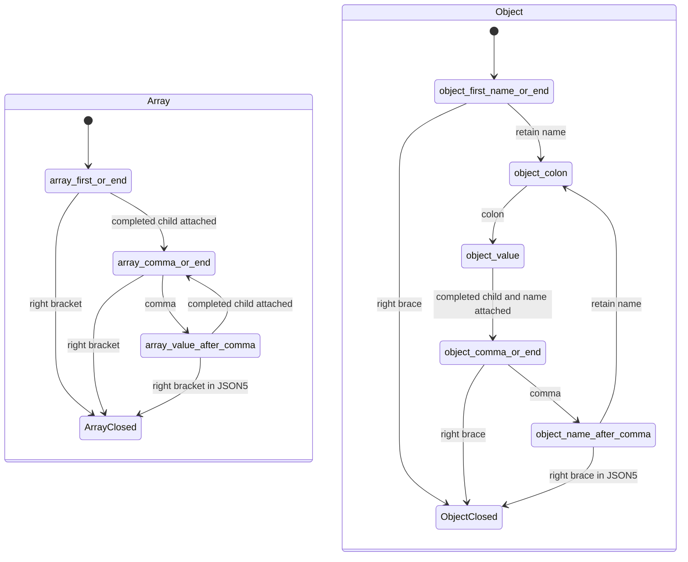

A nested container leaves its parent's frame waiting for the same value until
that child closes. The child's new frame becomes the top frame. This is how
mutually nested arrays and objects avoid C++ call-stack recursion.

## 8. Implemented internal engine

The teaching design is now implemented in the private engine header and
`src/src/parser/parser_engine.cpp`. These types are internal, not supported public
APIs. The class shape and prefix contract below remain unchanged by the refactor.

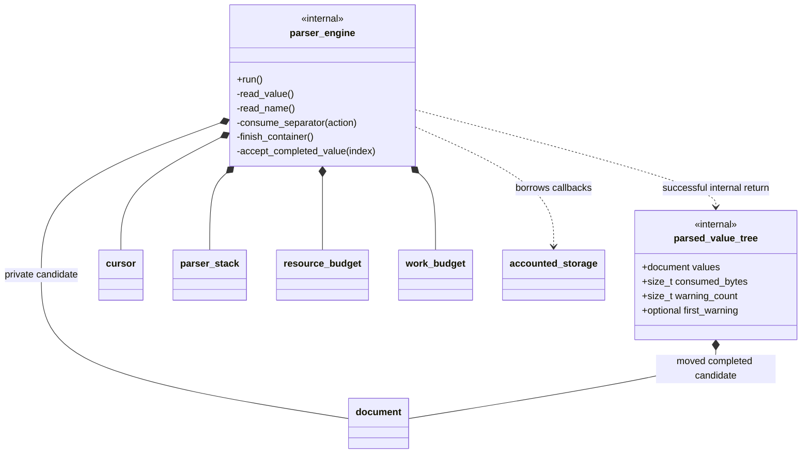

The engine owns private per-operation state: copied options/input
description, cursor, candidate document, frame stack, logical budget, work budget
and aggregate decoded-unit/warning counters. All allocations use the same caller
accounting adapter. A fresh instance is intended for each run; a failed or
completed instance is not a reusable parse context.

| Internal operation | Collaboration |
| --- | --- |
| `run()` | Validate input/accounting configuration, charge dispatch/trivia work, skip trivia, select an action and repeat until the root completes. Establish the root and transfer ownership only after success. |
| `read_value()` | Reserve node/member resources; open a container after depth admission, or recognize/build a scalar with shared limits and pass it to completion handling. |
| `read_name()` | Decode a name under the remaining aggregate unit allowance, reserve retained units/diagnostics, emplace the pending name and select `object_colon`. |
| `consume_separator()` | Validate/consume the selected comma or colon and change the innermost frame's state. |
| `finish_container()` | Recognize the closing punctuation, call `close_container()`, release depth and accept the completed container index. |
| `accept_completed_value()` | Reacquire the current parent frame and call `attach_parsed_value()`, or record the completed root if no parent remains. |
| `parsed_value_tree` | Own completed document plus consumed-prefix length and warning summary. This internal prefix result is not complete-input validation. |

Do not preserve a frame pointer across a stack push or pop. Do not publish a
partial candidate after an error. Aggregate accounting must cover names as well
as string values and must be admitted before the corresponding bounded growth;
full cross-component accounting remains separately tracked under #69.

### Intended interaction for `[{}]`

This is a design trace, not an executed result. Offsets are original input bytes.

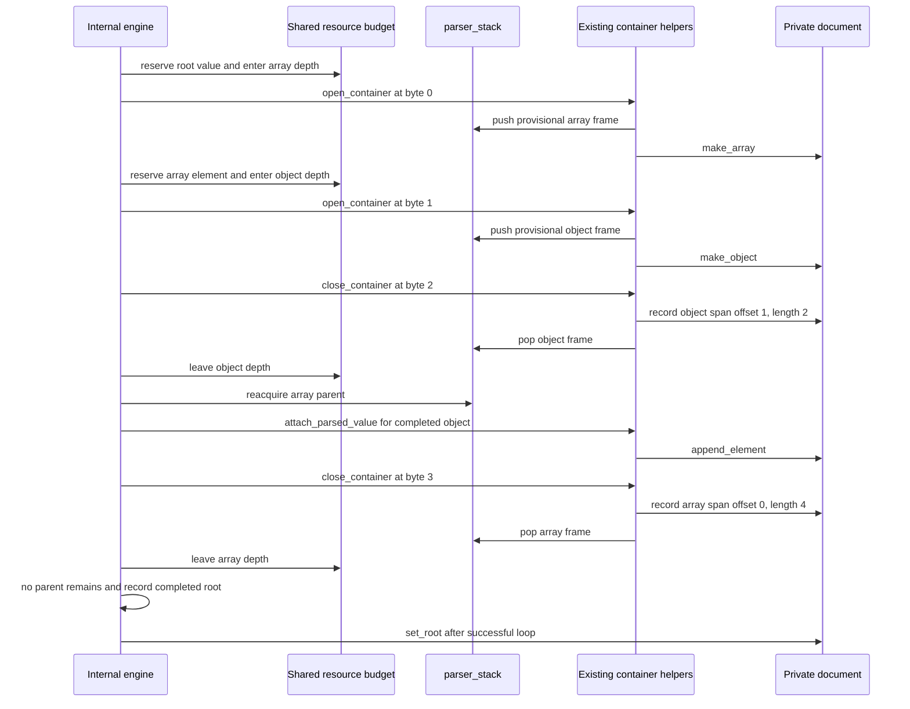

## 9. Failure boundaries and remaining work

| Boundary | Current contract / remaining integration |
| --- | --- |
| Lexical no-match | Successful empty optional; structural dispatch determines whether that absence is legal or a missing-value syntax error. |
| Lexical failure | Explicit original-offset error; transactional lexer cursor remains unchanged. Owned temporaries release themselves. |
| Helper mutation | Each helper has its own atomicity contract. Successful earlier steps need not be undone inside a candidate that is subsequently abandoned. This does not authorize publishing partial success. |
| Container open failure | Provisional frame rollback is in the helper; matching resource reservation rollback belongs to its caller. Existing frame pointers may already have been invalidated by growth. |
| Allocation failure | Report provider exhaustion separately from a configured byte ceiling. Minimal error reporting needs no new allocation. |
| Cleanup | Frame and record destruction is iterative; release needs no fresh allocation or extra work-budget admission. |
| Name spans | Frame/token offsets exist and records have an optional name-span field. Full population/exposure through parsing remains to be connected; attachment alone does not establish it. |
| Duplicate handling | Model/lookup preserve and expose duplicates. Explicit parser rejection policy and both colliding source locations remain P036 work. |
| Complete input | Primitive-only entry already requires EOF after trivia. Internal engine prefix success does not satisfy P037's unified complete-document contract. |
| Work accounting | Existing charges are component-specific. Whole-tree parsing and later traversal/conversion integration must be reviewed separately; finite record bounds alone do not prove all J5-048/J5-049 obligations. |
| Verification | P033 units and refactor regression results are recorded in verification notes. Requirement status is unchanged; P034?P037 and later whole-grammar evidence remain separate work. |

This snapshot covers all currently declared core classes, structs, enums and
architecturally significant aliases, including function-only modules. Local
result aliases inside functions and standard-library implementation types are
not separate parser components.
