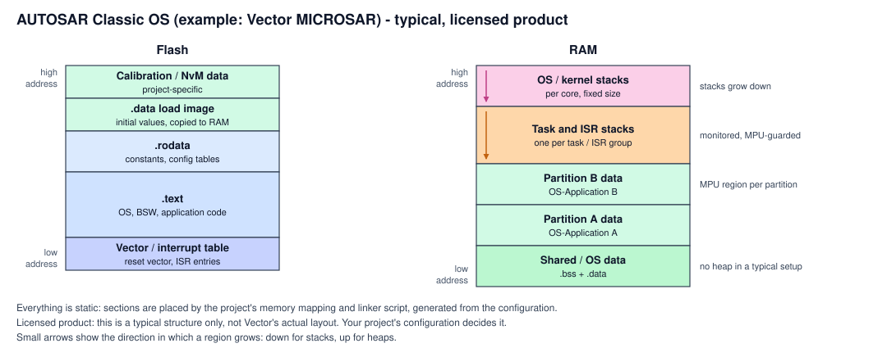
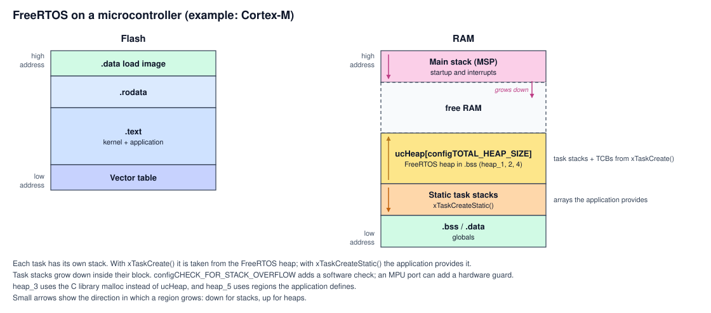
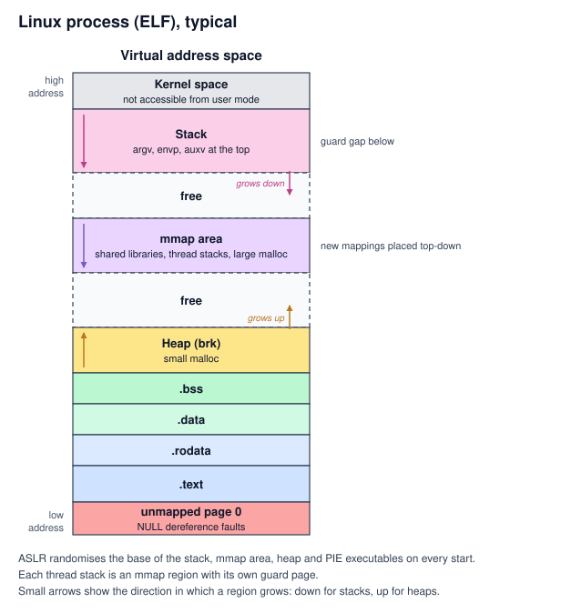
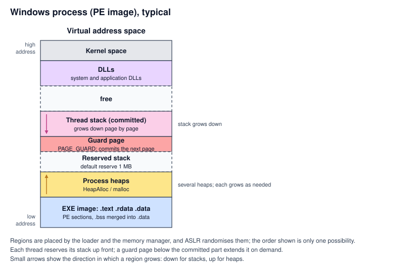
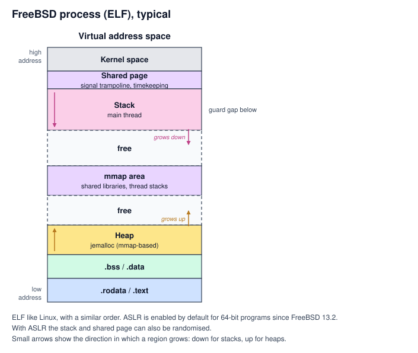

# Memory layout reference

A quick reference for where code and data live in memory, per environment: the
sections (`.text`, `.rodata`, `.data`, `.bss`), the heap and the stack, and in which
direction each one grows. It is general background for developers, not a requirement
of the library. Adaptive_JSON5's parser library itself uses no heap: only the
caller's buffer and the stack.

**Caveat: the CPU decides very little of this.** The linker script, the loader and the
operating system decide where each section goes. The pictures show a typical layout,
not a guarantee; check the map file of your own build. In every picture, high
addresses are at the top, and small arrows show the direction in which a region grows.

## Legend: what every label means

Read this first; it explains every name used in the pictures. Each block in the
pictures has the colour of its kind (for example, all stacks are pink), and the small
arrow inside a block shows the direction in which it grows.

### Sections of the program

| Name | Meaning | Contains | Where it lives |
| --- | --- | --- | --- |
| `.text` | "Text" is the traditional name for **code** | The machine instructions of the program | Flash on a microcontroller; read-only, executable pages under an OS |
| `.rodata` | **Read-only data** | Constants, string literals, lookup tables | Flash, or read-only pages |
| `.rdata` | Windows' name for `.rodata` in PE files | Same as `.rodata` | Read-only pages |
| `.data` | **Initialized data** | Global and static variables that have a starting value, such as `int count = 5;` | RAM. On a microcontroller the starting values are kept in flash (the **`.data` load image**) and **copied to RAM by the startup code** |
| `.bss` | **Zero-initialized data**. The name comes from an old assembler directive, "Block Started by Symbol" | Global and static variables that start as zero, such as `static char buffer[4096];` | RAM, **cleared to zero by the startup code** or by the OS. It takes no space in the program file, only its size is stored |
| Vector table | The table the CPU reads on reset and on interrupts | The initial stack pointer (on Cortex-M), the reset address and the address of every interrupt handler | Flash, usually at the start |
| Calibration / NvM data | Parameters that are tuned per vehicle, and non-volatile memory blocks | Calibration values, stored settings | Flash or EEPROM, project-specific |

### Memory regions at run time

| Name | Meaning |
| --- | --- |
| **Stack** | Memory for function calls: return addresses, saved registers and local variables. It grows **down**, toward lower addresses, on every architecture covered here. Every thread or task has its own. |
| **Main stack (MSP)** | On ARM Cortex-M, the stack used by the startup code and by interrupts. Its start address is the first entry of the vector table. |
| **Task stacks (PSP)** | On ARM Cortex-M, the stack of the currently running RTOS task. Each task has its own; the RTOS switches `PSP` between them. |
| **OS / kernel stacks** | Stacks reserved for the operating system itself, often one per CPU core. |
| **Heap** | Memory handed out while the program runs (`malloc`, `new`). It grows **up**. Often absent on safety-related microcontrollers; Adaptive_JSON5's parser library never uses it. |
| **Process heaps** | On Windows, a process can have several heaps (the process heap, the C runtime heap and others) instead of one region. |
| **`ucHeap`** | In FreeRTOS, the array of `configTOTAL_HEAP_SIZE` bytes, placed in `.bss`, from which `xTaskCreate()` takes task stacks and task control blocks. |
| **TCB** | Task control block: the RTOS's record for one task (its state, priority and saved stack pointer). |
| **Heap (brk)** | On Linux, the classic heap right after `.bss`, extended with the `brk` system call. Used for small allocations. |
| **mmap area** | Memory mapped by the OS on request: shared libraries, thread stacks and large allocations. |
| **Shared libraries / DLLs** | Code shared between programs: `.so` files on Linux and FreeBSD, `.dll` files on Windows. |
| **Shared page** | On FreeBSD, a page the kernel maps into every process, holding the signal trampoline and timekeeping data. |
| **Kernel space** | The part of the address space that belongs to the operating system. Programs cannot access it. |
| **Free / free RAM** | Space nobody uses yet. The stack and the heap grow into it. |
| **Reserved stack** | On Windows, address space set aside for a thread's stack (1 MB by default) but not yet backed by memory. |
| **Partition / OS-Application** | In AUTOSAR, a group of tasks and their data that the OS keeps apart from other groups using memory protection. |
| **Adaptive_JSON5 buffer** | The memory the integrator hands to the library; all parser storage lives in it. |

### Protection

| Name | Meaning |
| --- | --- |
| **Guard region / guard page / guard gap** | Memory placed below a stack that must never be touched. With memory protection active, any access to it raises a fault instead of silently overwriting the data below. |
| **Guard page (Windows)** | A page marked `PAGE_GUARD` below a thread's committed stack. Touching it commits the next page of the stack and moves the guard down. |
| **Unmapped page 0** | The lowest page of the address space is left unmapped, so using a null pointer faults immediately. |
| **MPU** | Memory protection unit: hardware on microcontrollers that restricts which code may access which memory regions. |
| **PMP** | Physical memory protection: the RISC-V equivalent of an MPU. |
| **MMU** | Memory management unit: hardware that provides virtual memory and page permissions under a full OS. |
| **`MSPLIM`, `PSPLIM`** | Stack limit registers on ARMv8-M cores (for example Cortex-M33). The hardware faults when the stack pointer goes below them. |
| **ASLR** | Address space layout randomization: the OS places the stack, heap and libraries at random addresses on every start, which makes memory bugs harder to exploit. |

---

## 1. Bare metal and RTOS

On a microcontroller everything is decided at build time by the linker script: there
is no loader and usually no virtual memory. Code and constants stay in flash; `.data`,
`.bss` and the stacks are in RAM.

### 1.1 AUTOSAR Classic OS (example: Vector MICROSAR)

> **Licensed product.** Vector MICROSAR is a commercial product, and its documentation
> is licensed. The picture below is a **typical example of an AUTOSAR Classic memory
> structure**, drawn from the public AUTOSAR concepts. It is not Vector's actual layout,
> and nothing in it is copied from Vector's documentation. Your project's configuration
> and linker script decide the real layout.

- **Everything is static.** The configuration tool generates the memory mapping, and
  the linker script places every section. A typical project has **no heap**.
- **Every task and interrupt group has its own fixed-size stack**, plus kernel stacks
  per core. The OS can monitor them for overflow (stack monitoring), and with memory
  protection the MPU guards them.
- **OS-Applications are separated into memory partitions.** With memory protection
  enabled, each partition's data sits in its own MPU region, so a fault in one cannot
  overwrite another.

### 1.2 FreeRTOS

- **Every task has its own stack.** With `xTaskCreate()`, the stack and the task control
  block come from the FreeRTOS heap: an array `ucHeap[configTOTAL_HEAP_SIZE]` in `.bss`,
  managed by one of the `heap_1` to `heap_5` schemes. With `xTaskCreateStatic()`, the
  application provides the stack as its own array.
- The **main stack** is used by the startup code and, on Cortex-M, by interrupts.
- `configCHECK_FOR_STACK_OVERFLOW` adds a software check at context switches; an MPU
  port can add a hardware guard below each task stack.

### Keep in mind: architecture differences (microcontrollers)

| Topic | ARM Cortex-M | RISC-V |
| --- | --- | --- |
| Stack direction | Down, **enforced by hardware**: `PUSH` and exception entry always lower `sp` | Down **by convention only** (psABI); there is no push or pop instruction |
| Initial stack pointer | First word of the vector table | Set by the startup code |
| Stack alignment | 8 bytes at function calls (AAPCS); the hardware aligns exception frames | 16 bytes (psABI) |
| Interrupts and the stack | The hardware pushes an exception frame onto the active stack | Software saves registers; no automatic frame |
| Two stack pointers | `MSP` (main, interrupts) and `PSP` (tasks) | One `sp`; RTOS switches it per task |
| Overflow detection in hardware | ARMv8-M: `MSPLIM` and `PSPLIM` stack limit registers. ARMv7-M (for example Cortex-M4): an MPU guard region only | No stack limit register in the base ISA: a PMP guard region, if configured |

---

## 2. Linux

- Every process has its own virtual address space. The executable is an **ELF** file.
- The **stack** of the main thread is at the top of user space and grows down, with a
  guard gap below it. `argv`, the environment and the auxiliary vector sit at its top.
- The **mmap area** holds shared libraries, thread stacks (each with a guard page) and
  large allocations; new mappings are placed top-down by default.
- The **heap** (`brk`) starts after `.bss` and grows up; it holds small allocations.
- **Page 0 is unmapped**, so dereferencing a null pointer faults.
- **ASLR** randomizes the base of the stack, the mmap area, the heap and
  position-independent executables on every start.

### Keep in mind: architecture differences (Linux)

| Topic | x86-64 | AArch64 | 32-bit ARM | RISC-V 64 | LoongArch64 |
| --- | --- | --- | --- | --- | --- |
| Stack direction | Down, enforced by hardware | Down (by convention) | Down (full-descending, required by the AAPCS) | Down (by convention) | Down (by convention) |
| Stack alignment | 16 bytes at calls | 16 bytes, can be checked by hardware | 8 bytes at calls | 16 bytes | 16 bytes |
| Red zone | **128 bytes** below `rsp` that functions may use without moving it | None | None | None | None |
| Page size | 4 KB | 4, 16 or 64 KB, depending on the kernel | 4 KB | 4 KB | Often 16 KB |
| User address space | 47 bits (128 TB) usually | 39 or 48 bits, depending on the kernel | About 3 GB | Depends on the paging mode (Sv39, Sv48) | Depends on the kernel |

The **red zone** matters for low-level code: signal handlers and the kernel skip those
128 bytes, but code that runs on someone else's stack, such as kernel code or interrupt
handlers, must be compiled without it (`-mno-red-zone`).

---

## 3. Windows

- The executable format is **PE**, not ELF. Its sections are usually `.text`, `.rdata`
  (read-only data) and `.data`; zero-initialized data is normally part of `.data`.
- **Each thread reserves its stack up front** (1 MB by default) but commits only the
  pages it uses. A **guard page** sits below the committed part; touching it commits the
  next page and moves the guard down. When the reserve is used up, the thread gets a
  stack overflow exception.
- A process can have **several heaps** (the process heap, the C runtime heap and
  others), so there is no single heap region.
- The loader and the memory manager place the image, DLLs, heaps and stacks, and
  **ASLR** randomizes them. The order in the picture is only one possibility.

### Keep in mind: architecture differences (Windows)

| Topic | x64 | ARM64 | x86 (32-bit) |
| --- | --- | --- | --- |
| Stack direction | Down, enforced by hardware | Down (by convention) | Down, enforced by hardware |
| Stack alignment | 16 bytes at calls | 16 bytes | 4 bytes traditionally |
| Red zone | **None**: unlike x86-64 Linux, nothing below `rsp` may be used | None | None |
| Shadow space | The caller reserves **32 bytes** above the return address for the callee | None | None |
| Large stack frames | Frames bigger than a page are touched page by page (`__chkstk`) so they cannot skip the guard page | Same | Same |
| Page size | 4 KB | 4 KB | 4 KB |

---

## 4. FreeBSD

- Executables are **ELF**, as on Linux, and the order of the regions is similar.
- The **shared page** near the top of user space holds the signal trampoline and
  timekeeping data.
- The **stack** of the main thread grows down from below it, with a guard gap.
- The default allocator (jemalloc) gets its memory mostly through `mmap`.
- **ASLR is enabled by default for 64-bit programs since FreeBSD 13.2.** With ASLR, the
  stack and the shared page can also be randomized.

### Keep in mind: architecture differences (FreeBSD)

| Topic | amd64 | arm64 | riscv64 |
| --- | --- | --- | --- |
| Stack direction | Down, enforced by hardware | Down (by convention) | Down (by convention) |
| Stack alignment | 16 bytes at calls | 16 bytes | 16 bytes |
| Red zone | **128 bytes**, as on x86-64 Linux | None | None |
| Page size | 4 KB | 4 KB | 4 KB |

---

## Where this is used

The [cybersecurity assumptions](ISO21434-cybersecurity/cybersecurity-assumptions.md#ca-03-how-memory-is-laid-out-and-why-it-matters)
explain, per architecture, why the stack layout matters for an attacker and where an
integrator should place guard regions.
